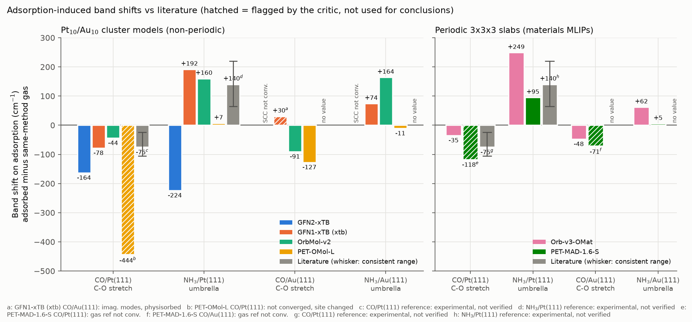
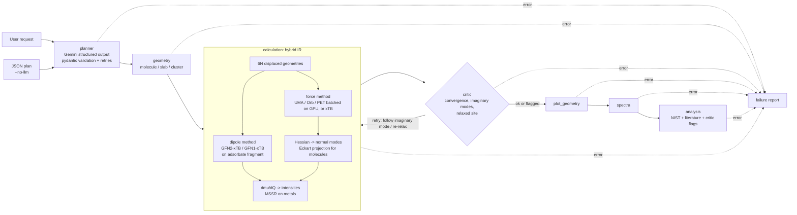

# IR Spectra Agent

An AI agent that turns a plain-language request ("IR spectrum of CO on Pt(111) with UMA") into a
complete vibrational-spectroscopy calculation for molecules and adsorbates on metal, silicon and
silica surfaces, using machine-learned interatomic potentials (Meta UMA, Orb, PET) and GFN-xTB. Every
result is checked against measured spectra (NIST gas-phase data and a curated table of published
surface IR/HREELS bands).

[](.github/workflows/ci.yml)



*Adsorption-induced band shifts of CO and NH3 on Pt(111) and Au(111) for six methods (cluster models
left, periodic slabs right) against the literature value and its consistency window; hatched bars
were flagged by the agent's critic and are not used for conclusions. The UMA-S 1.2.1 rows are in the
tables below.*

## Results at a glance

| Result | Value | Takeaway |
|---|---|---|
| Gas phase, error vs experimental *harmonic* frequencies (4 modes) | UMA omol 34, OrbMol-v2 31, PET-OMol-L 32 cm⁻¹ MAE (mean signed +3 cm⁻¹) | OMol25-trained models reproduce harmonic DFT; their ~90 cm⁻¹ offset from measured bands is anharmonicity |
| Gas phase, error vs measured fundamentals (11 modes) | UMA oc20 29, UMA omat 30 cm⁻¹ MAE | Best raw score, but 118-131 cm⁻¹ below the harmonic values: GGA softness cancels the anharmonicity |
| CO/Pt(111) C-O shift, UMA slabs | oc20 -55, omat -81 cm⁻¹ vs -75 to -54 cm⁻¹ measured (UHV IRAS, unverified) | Consistent with experiment; an omol gas reference instead of the same-task one would give -213 cm⁻¹ |
| CO/Cu(111) C-O shift | UMA omol / oc20 / omat -90 / -116 / -103 cm⁻¹ vs -66 cm⁻¹ measured (verified) | UMA over-binds CO on Cu; GFN1-xTB barely binds it (-7 cm⁻¹) |
| H/Si(100)-2x1 Si-H stretch, sym / asym | UMA oc20 2092 / 2081, omat 2106 / 2094 cm⁻¹ vs 2099 / 2088 cm⁻¹ measured | On the measured bands with the right splitting, again by error cancellation (harmonic estimate 2189 / 2178) |
| Isolated silanol O-H stretch | UMA omol 3896 cm⁻¹ vs harmonic estimate 3925 cm⁻¹ (measured 3747 cm⁻¹, verified; gap 178 cm⁻¹) | Stating the anharmonic gap explicitly changes which method looks right |
| CO site on Pt(111), UMA oc20 / omat | fcc 0.12 / 0.31 eV below atop; C-O ≈ 2030 / 1830 / 1745 cm⁻¹ atop / bridge / fcc | UMA prefers the wrong site (the GGA "CO/Pt(111) puzzle"), and the site moves the band by ~200-300 cm⁻¹ |
| Agent | 20/20 exact plans on 20 labelled prompts; 24-case UMA matrix in 1.7 min at 1.62 GiB on a laptop RTX 3070 | Reliable on routine requests; runs on a laptop GPU |

## Key findings

- **Right for the right reason.** Models trained on OMol25 (UMA omol, OrbMol-v2, PET-OMol-L) behave
  like harmonic DFT. GGA-level models (UMA oc20/omat, Orb-OMat, PET-MAD) match measured bands mainly
  because their soft bonds cancel the missing anharmonicity. Stating the measured-vs-harmonic gap
  explicitly, instead of folding it into a scale factor, exposes this.
- **References must come from the same model task.** An adsorption shift is only meaningful if the
  gas-phase reference uses the same UMA task: mixing tasks moves the CO/Pt shift from -55 to
  -213 cm⁻¹.
- **The adsorption site matters more than the method.** For the atop C-O band on Pt(111) the
  uncertainty ranks site (~200-300 cm⁻¹) > cluster vs slab (~80) > UMA task (~27) > coverage (4-7)
  > finite-difference step (<= 3), and UMA puts CO in the wrong site.
- **Limitation:** only 2 of the 9 measured surface references (CO/Cu, silanol) could be verified in
  the primary papers, and all calculations are harmonic, 0 K and at one dilute coverage, so the
  comparisons are consistency checks, not a ranking of methods.

The full technical record (methods, every table, caveats, negative results, compute used) is in
[REPORT.md](REPORT.md).

## Skills demonstrated

- **Agentic workflows for simulation.** An LLM planner (Gemini, pydantic-validated structured
  output with retries and model fallbacks) turns a request into a typed plan; a LangGraph workflow
  executes it; a critic node checks every calculation and retries or flags it; a 20-prompt harness
  measures planner accuracy. `--no-llm` makes the whole agent testable without an API key.
- **Materials foundation models (MLIPs).** Presets for Meta UMA-S 1.2.1 (`uma-omol`, `uma-oc20`,
  `uma-omat`: one fairchem task for the adsorbate *and* its gas reference), OrbMol-v2, Orb-v3-OMat,
  PET-OMol-L and PET-MAD-1.6, all validated on the same tables; displaced geometries are batched
  on the GPU.
- **Computational spectroscopy.** Harmonic vibrational analysis with exact rigid-body projection,
  IR intensities from dipole derivatives, the metal-surface selection rule, cluster vs slab models,
  and an explicit measured-vs-harmonic (anharmonic) gap.
- **Scientific validation.** NIST gas-phase data, a curated table of measured surface bands with
  technique, coverage, temperature, DOI and evidence level, site/coverage/step-size sensitivity, and
  an uncertainty budget for one band.
- **Engineering.** src-layout package, typed YAML config, logging, per-run output directories,
  MLflow tracking, ~110 pytest tests, ruff, CI, and a Colab launcher.

## How it works



Any node that fails routes to a failure report instead of crashing. The method in brief (details
and equations: REPORT.md §1-§2):

1. **Hessian** by central finite differences of the forces (δ = 0.01 Å) over the adsorbate atoms
   (partial Hessian on surfaces) or all atoms (molecules), with all displaced geometries batched
   through the MLIP on the GPU. The `xtb`/`xtb-gfn1` presets use xtb's own `--hess` Hessian,
   because finite differences of xtb 6.7.1's gradient split degenerate modes.
2. **Normal modes** from the mass-weighted Hessian, with exact projection of rigid-body modes for
   free molecules.
3. **IR intensities** `I_k = 42.2561 · |dμ/dQ_k|²` km/mol from dipole derivatives at the same
   displaced geometries: native dipoles where the method has them (xTB), otherwise GFN2-xTB on the
   isolated adsorbate fragment (hybrid route).
4. **Metal-surface selection rule:** on metals only the surface-normal component of dμ/dQ is IR
   active (Greenler 1966).
5. **Surface models:** periodic slabs for periodic methods; a frozen 10-atom cluster (Pt10, Au10,
   Cu10, Ru10) or an H-capped Si9H12 cluster for non-periodic methods.
6. **Critic:** convergence (retry: FIRE re-relaxation), imaginary modes (retry: follow the mode),
   site change, weak binding; anything still wrong is flagged in the report, not hidden.

## Results in detail

All numbers come from saved run outputs in `docs/validation/` (provenance:
[docs/validation/README.md](docs/validation/README.md)). Shifts are adsorbed band minus the gas band
of the *same* method (and the same UMA task). Bold = inside the "consistent" window of a reference;
⚑ = flagged by the critic and not used for conclusions.

**Gas phase and CO/NH3 on Pt** (REPORT.md §5-§8):

| Result | UMA omol | UMA oc20 | UMA omat | OrbMol-v2 | PET-OMol-L | Orb-v3-OMat | PET-MAD-1.6-S | GFN2-xTB | GFN1-xTB | Reference |
|---|---:|---:|---:|---:|---:|---:|---:|---:|---:|---|
| Gas phase, 11 fundamentals: MAE (cm⁻¹) | 90 | 29 | 30 | 92 | 92 | 61 | 76 | 93 | 99 | NIST CCCBDB |
| Gas phase vs experimental *harmonic* frequencies, 4 modes: MAE (cm⁻¹) | **34** | 131 | 118 | **31** | **32** | 85 | 72 | 161 | 148 | CCCBDB (H2O, CO) |
| CO/Pt(111) C-O shift (cm⁻¹) | -148 | **-55** | **-81** | **-44** | n.c. ⚑ | **-35** | -118 ⚑ | -164 | **-78** | -75 to -54 (UHV IRAS, unverified); window -105..-24 |
| NH3/Pt(111) umbrella shift (cm⁻¹) | +202 ⚑ | **+120** | +134 ⚑ | **+160** | +7 | +249 | **+95** | -224 | **+192** | +140 (EELS, unverified); window +65..+220 |
| Model for adsorbates | Pt10 cluster | slab | slab | cluster | cluster | slab | slab | cluster | cluster | |

Flags: UMA ⚑ = a small imaginary mode of a rigid-body motion (NH3 rotating about the metal-N axis),
not of the band shown. PET-OMol-L CO/Pt did not converge and moved to a bridge site (n.c.). PET-MAD
CO uses a gas reference that stopped at fmax 0.025 eV/Å. Au rows (qualitative only) are in REPORT.md §6-§7.

**Semiconductor-process adsorbates** (REPORT.md §10). Measured values from
[data/reference/experimental_surface_ir.csv](data/reference/experimental_surface_ir.csv); "harm.
est." = measured fundamental + the anharmonic gap from
[anharmonicity.csv](data/reference/anharmonicity.csv) (Si-H +90, O-H +178 cm⁻¹).

| system, band (cm⁻¹) | GFN1-xTB | UMA omol | UMA oc20 | UMA omat | measured | harm. est. |
|---|---:|---:|---:|---:|---:|---:|
| CO/Cu(111), C-O shift | -7 ⚑ | **-90** | -116 | -103 | -66 (RAIRS 80 K, lowest dose; verified) | -66..-56 |
| CO/Ru(0001), C-O shift | **-148** | **-180** | **-160** | **-178** | -167 (lowest coverage; unverified) | -157 |
| H/Si(100)-2x1, Si-H sym / asym | 2040 / 2038 | 2235 / 2227 | 2092 / 2081 | 2106 / 2094 | 2099 / 2088 (unverified) | 2189 / 2178 |
| NH2+H/Si(100), Si-H / NH2 scissor | 2032 / 1507 | 2212 / 1566 | 2067 / 1512 | 2089 / 1508 | 2077 / 1534 (porous Si; unverified) | 2167 / - |
| isolated SiOH, O-H | 3883 | 3896 | 3747 | 3838 | 3747 (verified) | 3925 |

GFN1-xTB ⚑ on CO/Cu: CO is barely bound (Cu-C 2.50 Å) and has imaginary modes.

**CO site x UMA task x coverage on Pt(111)** (REPORT.md §11):

| UMA task, cell | CO atop | CO bridge | CO fcc | E_fcc - E_atop | NH3 atop shift |
|---|---:|---:|---:|---:|---:|
| oc20, 3x3 / 4x4 | 2031 / 2027 | 1829 / 1823 | 1740 / 1732 | -0.12 / -0.13 eV | +120 / +136 |
| omat, 3x3 / 4x4 | 2037 / 2031 | 1835 / 1832 | 1751 / 1747 | -0.31 / -0.31 eV | +133 ⚑ / +136 ⚑ |

Bands in cm⁻¹. All sites hold during relaxation; the fcc preference is the GGA "CO/Pt(111) puzzle"
(Feibelman et al. 2001), inherited from the RPBE/PBE training data.

**Agent.** The planner produced 20/20 exact plans on 20 labelled prompts with 0 validator
rejections; the configured `gemini-3.8-flash` was overloaded, so its fallback models answered
([docs/planner_eval](docs/planner_eval/gemini-3.8-flash.md)). Batching the displaced geometries
makes the Hessian step 3.5-7.7x faster (random-weight UMA-S proxy benchmark, REPORT.md §7).

## Calculators

`ir-agent calculators` prints what is usable on the current machine.

| preset | method | periodic | dipoles | GPU | notes |
|---|---|:-:|:-:|:-:|---|
| `uma-omol` | Meta UMA-S 1.2.1, omol task (fairchem 2.21, local checkpoint) | cluster model | hybrid | yes | gated weights (see below) |
| `uma-oc20`, `uma-omat` | UMA-S 1.2.1, oc20 / omat task | yes | hybrid | yes | gas reference with the same task as the slab |
| `uma` | UMA-S 1.2.1, omol for molecules, oc20 for slabs | yes | hybrid | yes | slab shifts referenced to `uma-oc20` gas |
| `orb-mol` | OrbMol-v2 (OMol25 + OPoly26, conservative) | cluster model | hybrid | yes | Apache-2.0; own venv (`.venv-orb`) |
| `orb-omat` | Orb-v3 conservative-inf-OMat (OMat24) | yes | hybrid | yes | Apache-2.0; molecules are out of distribution |
| `pet-omol` | PET-OMol-L v1.0.0 (OMol25) | cluster model | hybrid | yes | BSD-3-Clause; own venv (`.venv-pet`) |
| `pet-mad` | PET-MAD-1.6-S (r2SCAN, incl. surfaces) | yes | hybrid | yes | BSD-3-Clause |
| `xtb` | GFN2-xTB, `xtb` executable (`--hess` Hessian) | cluster model | native | - | SCC fails for metallic Au clusters |
| `xtb-gfn1` | GFN1-xTB, `xtb` executable (`--hess` Hessian) | cluster model | native | - | converges for Au, Pt, Cu, Ru clusters |
| `tblite` | GFN2-xTB, Python API | yes | native | - | Linux (conda-forge) |
| `dxtb` | GFN1-xTB in PyTorch | - | Mulliken-charge dipole* | yes | molecules only (diverges on metal clusters) |
| `dftb+`, `gpaw`, `nwchem` | DFTB+ / plane-wave DFT | yes | native / hybrid | - | Linux/WSL, not re-tested |
| `vasp`, `vasp-accurate` | VASP PBE | yes | native | - | licensed, untested |
| `emt` | ASE EMT | yes | hybrid | - | toy potential for workflow tests only |

\* dxtb's field-derivative dipole needs `tad-libcint` (Linux only); without it the dipole is Σqᵢrᵢ.

A missing calculator raises `CalculatorUnavailableError` with install instructions.

## Install

Tested on Windows 11 (Python 3.11, RTX 3070 Laptop, CUDA 12.8 driver) and in Linux CI.

```bash
git clone https://github.com/ryanlai666/IR_spectra_agent.git && cd IR_spectra_agent
uv venv .venv --python 3.11 && source .venv/bin/activate     # Windows: .venv\Scripts\activate
uv pip install torch==2.8.0 --index-url https://download.pytorch.org/whl/cu128
uv pip install --override requirements/ci-overrides.txt -e ".[llm,dev,tracking,dxtb,uma]"
# xtb 6.7.1 executable: conda-forge ...
conda create -y -p ./.tools/xtb -c conda-forge xtb=6.7.1
# ... or the release archive from https://github.com/grimme-lab/xtb/releases/tag/v6.7.1, then set IR_AGENT_XTB_BIN
ir-agent calculators
ir-agent run --no-llm --plan examples/plans/h2o_gas_xtb.json
```

`requirements/ci-overrides.txt` lets dxtb's `numpy<2` pin coexist with fairchem (numpy 2 works);
`requirements/overrides.txt` is the Windows dev variant (torch 2.11), and `requirements-lock*.txt`
freeze the tested environments.

**Orb and PET** need Python >= 3.12 and conflicting `nvalchemi-toolkit-ops` pins, so each gets its
own venv:

```bash
uv venv .venv-orb --python 3.12 && source .venv-orb/bin/activate
uv pip install torch==2.8.0 --index-url https://download.pytorch.org/whl/cu128
uv pip install orb-models==0.7.0 -e ".[dev]" && deactivate
uv venv .venv-pet --python 3.12 && source .venv-pet/bin/activate
uv pip install torch==2.8.0 --index-url https://download.pytorch.org/whl/cu128
uv pip install upet==0.3.1 -e ".[dev]" && deactivate
```

Checkpoints (no authentication): Orb from its public S3 bucket into `data/raw/orb/`, PET from
<https://huggingface.co/lab-cosmo/upet> into `data/raw/pet/`. URLs and SHA-256 hashes are in
[DATA.md](DATA.md).

**UMA (gated).** Request access at <https://huggingface.co/facebook/UMA> and accept its licence,
download `checkpoints/uma-s-1p2p1.pt` (UMA-S 1.2.1, 2.33 GB), check that its MD5 is
`3497615fd30a24c5b35cd3b41a682e6e`, and place it at `data/checkpoints/uma-s-1p2p1.pt` (gitignored).
The preset loads the local file with fairchem's `load_predict_unit` and needs no Hugging Face access
at run time; a wrong MD5 is a hard error. Set `calculators.uma.allow_hub_download: true` to use the
gated hub download instead.

**Colab:** [notebooks/colab_launcher.ipynb](notebooks/colab_launcher.ipynb) clones the repo,
installs fairchem/tblite/xtb, runs the real-UMA GPU test and the validation matrix with `--resume`
on Google Drive.

## Usage

```bash
ir-agent run "Compute the IR spectrum of NH3 on Pt(111) with xtb"     # LLM planner (needs GOOGLE_API_KEY)
ir-agent run --no-llm --plan examples/plans/co_pt111_uma.json          # no API key needed
ir-agent validate --calculators xtb,xtb-gfn1 --surfaces CO/Pt/111,CO/Pt/111/bridge
ir-agent graph                                                          # mermaid diagram of the LangGraph
```

`--surfaces` takes `MOL/METAL/FACET[/SITE]` (site ontop by default). Every run writes
`runs/<timestamp>_<label>/` with the plan, log, structures, optimizer logs, `plots/ir_spectrum.png`,
`ir_result.json`, `spectrum.json` and `report.md`; parameters and metrics also go to MLflow.
Configuration lives in [configs/default.yaml](configs/default.yaml); keys are read from the
environment or `.env` (copy [.env.example](.env.example)).

The LLM defaults to `gemini-3.8-flash`, falling back to `gemini-3.6-flash` and
`gemini-3.5-flash-lite`. Planner output is validated by pydantic (molecule name, facet, element,
calculator); on failure the validator message is fed back for up to 3 retries per model.

## Reproduce the results

```bash
pytest -q                                                    # CPU tests (~2 min)
ir-agent validate --calculators xtb,xtb-gfn1                 # xTB matrix (~5 min CPU)
.venv-orb/bin/ir-agent validate --calculators orb-mol,orb-omat   # Orb matrix (~7 min CPU)
.venv-pet/bin/ir-agent validate --calculators pet-omol,pet-mad   # PET matrix (~7 min CPU)
python scripts/run_uma_run_a.py      # Run A: UMA-S 1.2.1 on the gas + Pt/Au matrix (GPU, ~2 min)
python scripts/run_uma_run_b.py      # Run B: CO site x UMA task x coverage (GPU, ~5 min)
python scripts/site_energies.py      # Run B CO site energies (GPU)
python scripts/run_c.py --cpu        # Run C, GFN1-xTB part (CPU, ~2 min)
python scripts/run_c.py --gpu        # Run C, UMA part (GPU, ~4 min)
python scripts/benchmark_uma_proxy.py    # random-weight UMA-S proxy timing benchmark (GPU)
python scripts/classify_sites.py runs/<run dir> ...       # relaxed sites + convergence from saved runs
python scripts/make_report_figures.py                     # figures + summary_tables.md from saved JSON
python scripts/eval_planner.py                            # planner accuracy (needs GOOGLE_API_KEY)
```

Windows paths use `.venv\Scripts\...`. On a shared GPU, set `GPU_GUARD` to the path of a GPU guard
script and the run scripts launch their CUDA jobs through it (`python $GPU_GUARD run --agent
ir-agent --gb <GB> -- <command>`; see `src/ir_agent/gpu.py`). Without `GPU_GUARD` they run directly.
Validation runs accept `--resume RUN_DIR` and checkpoint each case.

## Data sources and licences

| Data / model | Use | Licence and attribution |
|---|---|---|
| NIST CCCBDB experimental vibrational frequencies (SRD 101) | gas-phase fundamentals, intensities and harmonic frequencies | US Government work; values from Shimanouchi (NSRDS-NBS 39, 1972) and Huber & Herzberg (1979) as cited on each page |
| Measured surface bands and anharmonic gaps ([data/reference/](data/reference/)) | adsorbate references | numbers from the cited literature (citation and DOI per row) |
| Meta UMA-S 1.2.1 (`facebook/UMA`) | `uma*` presets | gated; licence terms on the Hugging Face page (not redistributed here). Wood *et al.*, arXiv:2506.23971 |
| Orb models (OrbMol-v2, Orb-v3-OMat) | `orb-*` presets | Apache-2.0; Rhodes *et al.*, arXiv:2504.06231 |
| UPET / PET models (PET-OMol-L, PET-MAD-1.6-S) | `pet-*` presets | BSD-3-Clause; lab-cosmo/upet |
| xtb 6.7.1 | GFN1/GFN2-xTB | LGPL-3.0; Bannwarth *et al.* 2019, Grimme *et al.* 2017 |
| DFTB+ Slater-Koster sets (optional) | `dftb+` preset | terms on dftb.org (not redistributed) |

No training data is used: all structures are generated with ASE. Details, file sizes and hashes:
[DATA.md](DATA.md).

## Limitations

- **Harmonic, 0 K, small models.** One adsorbate per cell at dilute coverage; clusters are tiny and
  frozen (10 metal atoms) and outside the OMol models' training data; Orb-OMat is out of
  distribution for molecules.
- **One UMA checkpoint (UMA-S 1.2.1).** Both UMA tasks prefer the wrong CO site on Pt(111); the NH3
  rows keep a soft axial-rotor imaginary mode.
- **Few verified experimental numbers.** Only CO/Cu(111) and the isolated silanol were read in the
  primary papers; CO/Pt, CO/Ru, H/Si and NH2+H/Si (porous Si) values are secondary or abstract-only;
  the NH3/Pt value may come from an NH3-NO co-adsorption study; Au has no number. The comparisons
  are consistency checks, not rankings.
- **MLIP intensities come from GFN2-xTB fragment dipoles** (hybrid route), not from the MLIPs, and
  neglect metal screening and charge transfer: RAIRS intensities are relative, not quantitative.
- **GFN2-xTB SCC does not converge** for Au10 clusters (GFN1 does); dxtb diverges on metal
  clusters.
- The planner table measures the deployed fallback chain, not `gemini-3.8-flash` alone, on 20
  prompts.
- DFTB+, GPAW and NWChem presets are Linux/WSL-only and were not re-tested; VASP is untested.

The full technical report, with every table, caveat and negative result, is [REPORT.md](REPORT.md).

## Repository layout

```
src/ir_agent/
  agent/        plan.py (plan schema), llm.py (Gemini + retries), nodes.py, graph.py, planner_eval.py
  calculators/  registry.py (presets), uma.py, orb.py, pet.py, xtb_binary.py, dxtb_calc.py
  vibrations/   finite_diff.py, normal_modes.py, intensities.py (MSSR), evaluators.py, ir.py
  validation/   reference.py, experimental.py, run.py (validation matrix), run_c.py
  critic.py  sites.py  semis.py (Si/SiO2 models)  structures.py  spectrum.py  analysis.py
  pipeline.py  plotting.py  tracking.py  gpu.py  config.py  cli.py
configs/default.yaml     data/reference/*.csv     examples/plans/*.json     examples/planner_eval/
scripts/   run_uma_run_a.py, run_uma_run_b.py, run_c.py, site_energies.py, benchmark_uma_proxy.py,
           smoke_mlip_gpu.py, make_report_figures.py, classify_sites.py, eval_planner.py, package_tester/
docs/      figures/, validation/ (run outputs), benchmarks/, planner_eval/
tests/     notebooks/colab_launcher.ipynb     REPORT.md     DATA.md
```

## Development

```bash
pytest -q                     # CPU tests (unit + integration)
pytest -m "gpu and uma"       # real UMA on CUDA (needs the checkpoint)
ruff check src tests
```

## References

- B. M. Wood *et al.*, "UMA: A Family of Universal Models for Atoms", [arXiv:2506.23971](https://arxiv.org/abs/2506.23971) (2025).
- B. Rhodes *et al.*, "Orb-v3: atomistic simulation at scale", [arXiv:2504.06231](https://arxiv.org/abs/2504.06231) (2025); orb-models <https://github.com/orbital-materials/orb-models> (OrbMol-v2 is described in its MODELS.md).
- UPET / PET models: <https://huggingface.co/lab-cosmo/upet>, <https://github.com/lab-cosmo/upet>. PET-MAD-1.6: [arXiv:2603.02089](https://arxiv.org/abs/2603.02089); UPET architecture: F. Bigi *et al.*, [arXiv:2601.16195](https://arxiv.org/abs/2601.16195).
- FAIR Chemistry, `fairchem`: <https://github.com/facebookresearch/fairchem>; checkpoints <https://huggingface.co/facebook/UMA>.
- C. Bannwarth, S. Ehlert, S. Grimme, "GFN2-xTB", *J. Chem. Theory Comput.* 15, 1652 (2019), [doi:10.1021/acs.jctc.8b01176](https://doi.org/10.1021/acs.jctc.8b01176).
- S. Grimme, C. Bannwarth, P. Shushkov, "GFN1-xTB", *J. Chem. Theory Comput.* 13, 1989 (2017), [doi:10.1021/acs.jctc.7b00118](https://doi.org/10.1021/acs.jctc.7b00118).
- C. Bannwarth *et al.*, "Extended tight-binding quantum chemistry methods", *WIREs Comput. Mol. Sci.* 11, e01493 (2020), [doi:10.1002/wcms.1493](https://doi.org/10.1002/wcms.1493).
- M. Friede *et al.*, "dxtb – an efficient and fully differentiable framework for extended tight-binding", *J. Chem. Phys.* 161, 062501 (2024), [doi:10.1063/5.0216715](https://doi.org/10.1063/5.0216715).
- A. Hjorth Larsen *et al.*, "The atomic simulation environment – a Python library for working with atoms", *J. Phys.: Condens. Matter* 29, 273002 (2017), [doi:10.1088/1361-648X/aa680e](https://doi.org/10.1088/1361-648X/aa680e).
- R. G. Greenler, "Infrared study of adsorbed molecules on metal surfaces by reflection techniques", *J. Chem. Phys.* 44, 310 (1966), [doi:10.1063/1.1726462](https://doi.org/10.1063/1.1726462).
- P. J. Feibelman *et al.*, "The CO/Pt(111) Puzzle", *J. Phys. Chem. B* 105, 4018 (2001), [doi:10.1021/jp002302t](https://doi.org/10.1021/jp002302t).
- NIST CCCBDB, experimental vibrational frequencies (SRD 101): <https://cccbdb.nist.gov>.
- Measured surface bands (main sources; every row with its DOI is in [experimental_surface_ir.csv](data/reference/experimental_surface_ir.csv)):
  - B. E. Hayden, A. M. Bradshaw, *Surf. Sci.* 125, 787 (1983), [doi:10.1016/S0039-6028(83)80060-0](https://doi.org/10.1016/S0039-6028(83)80060-0) and R. Tüshaus *et al.*, *J. Electron Spectrosc. Relat. Phenom.* 44, 305 (1987), [doi:10.1016/0368-2048(87)87031-7](https://doi.org/10.1016/0368-2048(87)87031-7) (CO/Pt(111), UHV IRAS; values seen as quotes only).
  - D. Zhang *et al.*, *J. Phys. Chem. C* 126, 13114 (2022), [doi:10.1021/acs.jpcc.2c02541](https://doi.org/10.1021/acs.jpcc.2c02541) (CO/Cu(111), RAIRS; verified).
  - P. Jakob, *Phys. Rev. Lett.* 77, 4229 (1996), [doi:10.1103/PhysRevLett.77.4229](https://doi.org/10.1103/PhysRevLett.77.4229) (CO/Ru(0001) overtone and anharmonicity).
  - Y. J. Chabal, K. Raghavachari, *Phys. Rev. Lett.* 53, 282 (1984), [doi:10.1103/PhysRevLett.53.282](https://doi.org/10.1103/PhysRevLett.53.282) (H/Si(100)-2x1).
  - P. Guyot-Sionnest, *Phys. Rev. Lett.* 67, 2323 (1991), [doi:10.1103/PhysRevLett.67.2323](https://doi.org/10.1103/PhysRevLett.67.2323) (Si-H hot band, anharmonicity).
  - A. C. Dillon *et al.*, *MRS Proc.* 204, 339 (1990), [doi:10.1557/PROC-204-339](https://doi.org/10.1557/PROC-204-339) (NH3 on porous Si).
  - M. Werghi *et al.*, *Chem. Sci.* 9, 3531 (2018), [doi:10.1039/C7SC05200F](https://doi.org/10.1039/C7SC05200F) (isolated silanol 3747 cm⁻¹; verified).
  - J. L. Gland, B. A. Sexton, *J. Catal.* 68, 286 (1981), [doi:10.1016/0021-9517(81)90098-1](https://doi.org/10.1016/0021-9517(81)90098-1) (NH3/Pt(111) 1090 cm⁻¹; not verified, the paper concerns an NH3·NO complex).

## License

MIT (see [LICENSE](LICENSE)). Third-party models and parameter sets keep their own licences (see
[DATA.md](DATA.md)).
