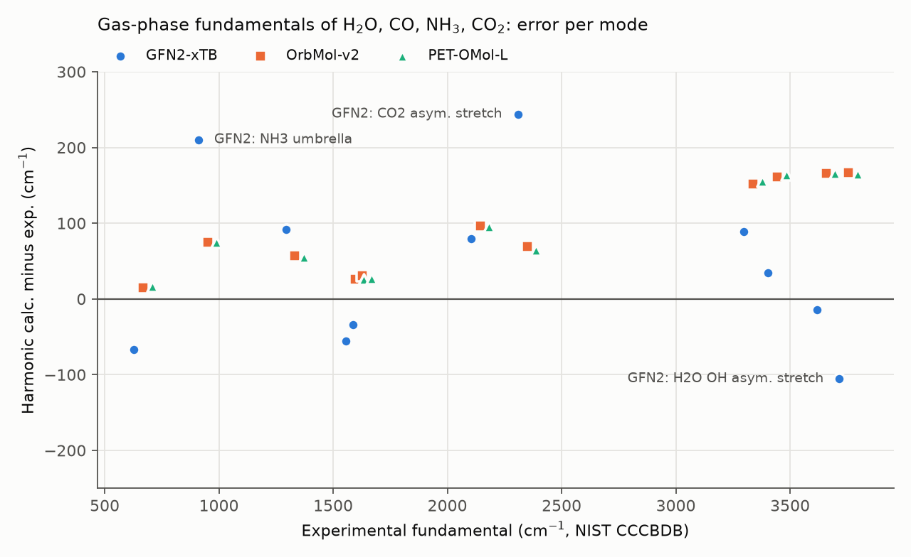
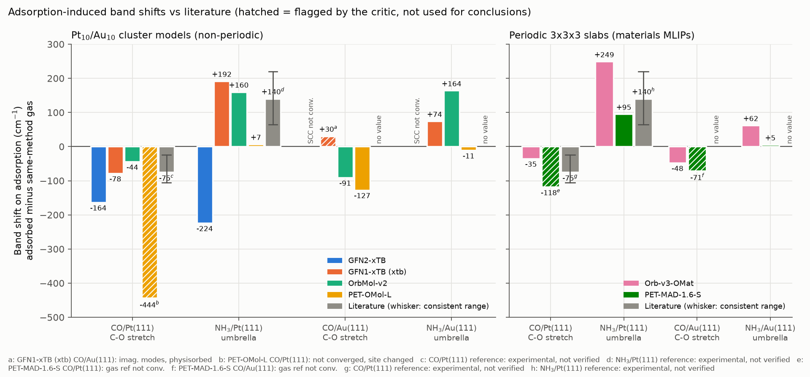
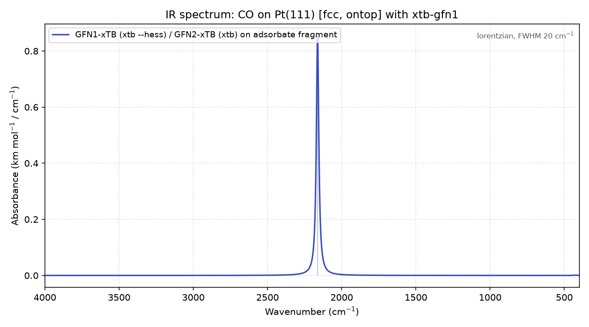
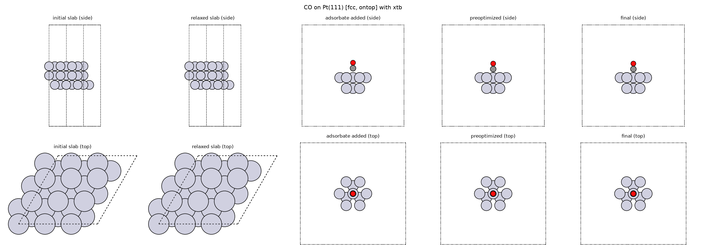
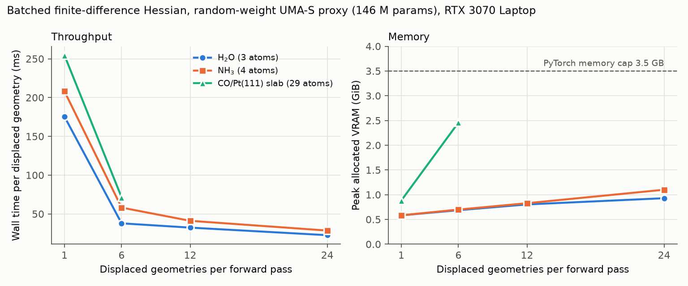
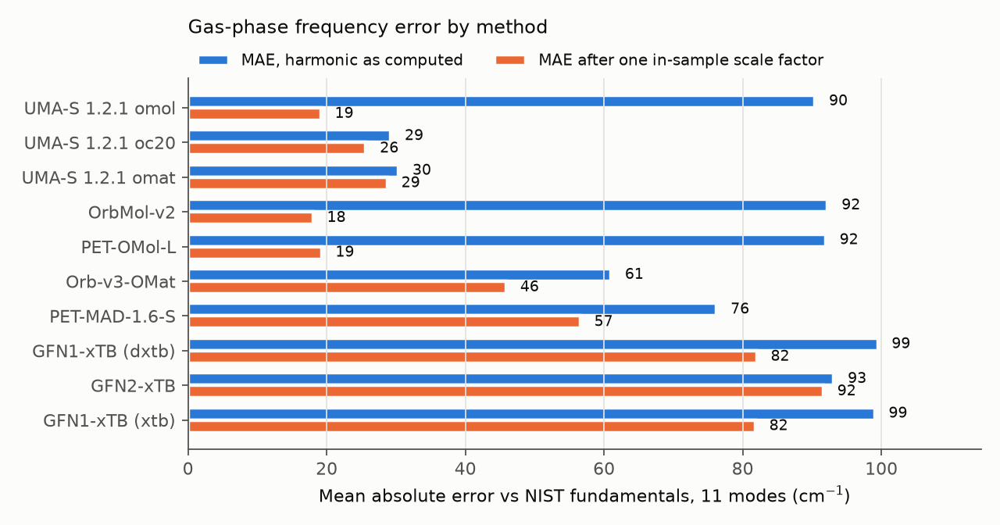

# IR Spectra Agent: technical report

This report is the technical record behind [README.md](README.md): methods, every result table,
caveats, negative results and the compute used. Every number comes from a saved run output in
`docs/` (provenance: [docs/validation/README.md](docs/validation/README.md)):
- `docs/validation/validation_xtb.json`: GFN2-xTB and GFN1-xTB (`xtb --hess` route)
- `docs/validation/validation_dxtb.json`: GFN1-xTB in PyTorch (dxtb)
- `docs/validation/validation_orb.json`, `validation_pet.json`: Orb and PET presets
- `docs/validation/validation_uma.json`: UMA-S 1.2.1, Run A (§7)
- `docs/validation/run_b/`: Run B per point, `summary.json` and `site_energies.json` (§11)
- `docs/validation/run_c_*.json/.md`, `validation_run_c_*.json/.md`: Run C (§10)
- `docs/planner_eval/gemini-3.8-flash.json/.md`: planner accuracy (§12)
- `data/reference/experimental_surface_ir.csv`, `anharmonicity.csv`: measured surface bands with
  technique, coverage, temperature, DOI and evidence level, and the anharmonic gaps (§9)
- `docs/validation/adsorbate_sites.json`, `convergence.json`: relaxed site and final fmax per case
  (`scripts/classify_sites.py`)
- `docs/benchmarks/uma_proxy_benchmark_*.json`: UMA-S proxy GPU benchmark (§7)

Figures and `docs/validation/summary_tables.md` are regenerated from these files by
`python scripts/make_report_figures.py`.

**Not included** (superseded or not meaningful): results of the v0.1 prototype (DFTB+/EMT with unit
"mock" intensities); xTB frequencies from finite differences of `xtb --grad`, a route that split
degenerate modes and was replaced (§2); EMT rows (a toy potential for workflow tests); dxtb IR
intensities (Mulliken-charge dipole only); GPU smoke-test timings; and the first NH2+H/Si(100)
slab model, whose cell was too small (§10).

The three validation sets are called **Run A** (UMA-S 1.2.1 on the gas + Pt/Au matrix), **Run B**
(CO site x UMA task x coverage on Pt(111)) and **Run C** (adsorbates from semiconductor processing),
after the scripts that run them (`scripts/run_uma_run_a.py`, `run_uma_run_b.py`, `run_c.py`).

## 1. Pipeline and method

The agent is a LangGraph workflow: planner → geometry → calculation → critic → plot_geometry →
spectra → analysis, with a failure branch from every node (diagram in the README). The planner
(Gemini, structured output validated by pydantic) turns a request into a typed plan; `--no-llm`
takes a JSON plan instead. The critic (§12) checks every calculation and retries or flags it.

IR spectra are computed in the double-harmonic approximation:

1. **Hessian.** Central finite differences of the forces (δ = 0.01 Å, 2- or 4-point stencil) over
   the adsorbate atoms (partial Hessian on surfaces) or all atoms (molecules). All `6N` displaced
   geometries are generated up front, so an MLIP evaluates them in a few GPU batches
   (`UMABatchForces`, capped at 180 atoms per forward pass to fit an 8 GB GPU). Exception: the
   `xtb`/`xtb-gfn1` presets use xtb's own `--hess` Hessian (§2).
2. **Normal modes.** Diagonalize the mass-weighted Hessian. For free molecules the 5 or 6
   rigid-body modes are projected out exactly; ASE's `Infrared` does not do this, and residual
   gradients then leave spurious "rotations" (one at 380 cm⁻¹ for GFN2-xTB water). Linearity is
   decided from the principal moments of inertia, so float32 MLIP relaxations that leave CO2 bent
   by a fraction of a degree are still treated as linear.
3. **Dipole derivatives** at the *same* displaced geometries from a dipole-capable method. If the
   force method has native dipoles (xTB, tblite, GPAW, VASP), ASE's `Infrared` runs the
   displacements. Otherwise (MLIPs, EMT, DFTB+) the hybrid route evaluates GFN2-xTB (xtb program
   or tblite) or GFN1-xTB on the **isolated adsorbate fragment** at each displaced geometry.
4. **Intensities.** `I_k = 42.2561 · |dμ/dQ_k|²` km/mol with dμ/dQ in D/(Å·amu^½), identical to
   ASE's `Infrared` (unit-tested exactly on a toy model; an analytic heteronuclear diatomic matches
   to 1e-4 relative).
5. **Metal-surface selection rule (MSSR).** On a metal only the surface-normal component of dμ/dQ
   is IR active (Greenler 1966): `I_k ∝ (dμ/dQ_k · n)²`, with an optional image-dipole factor 4.

The fragment dipole ignores metal screening and dynamic charge transfer, which mainly affects
absolute intensities rather than band positions. Every surface row uses the same fragment-dipole
model, so intensities are comparable across methods. xtb's whole-cluster dipole (CO/Pt10: 1010-1534
km/mol vs ~27 for the fragment) includes the polarization of a 10-atom metal cluster; it is stored
separately and not compared.

Surface models: periodic slabs for periodic methods; for non-periodic methods a frozen 10-atom
cluster (7 top-layer + 3 second-layer atoms around the site). Shifts are always taken against a gas
run of the same method, and for UMA of the same task (§2).

## 2. Design decisions and known pitfalls

| Issue | Evidence | Decision |
|---|---|---|
| Finite differences of xtb 6.7.1's `--grad` gradient split degenerate modes | GFN1 NH3 degenerate deformation 1235/1610 cm⁻¹ from finite differences vs 1611/1611 from `xtb --hess`/`--ohess` and from dxtb. The single-point gradient is not rotationally invariant for slightly distorted near-symmetric geometries (torque ~1e-3 Eh on an isolated molecule). Symmetry handling, SCC accuracy, electronic temperature, restarts and step size were ruled out. | `xtb`/`xtb-gfn1` use xtb's own `--hess` Hessian; dipole derivatives are still finite differences. Regression tests: NH3 and CO2 degenerate pairs within 1 cm⁻¹ and equal to xtb's own IR output; water within 1 cm⁻¹, intensities within 5 % (`tests/test_xtb_hessian.py`). Results from the old route are not reported. |
| An adsorption shift must compare like with like | A harmonic DFT value for adsorbed NH3 minus the anharmonic gas fundamental mixes two kinds of frequency. | References are fundamental vs fundamental (measured adsorbed band minus measured gas band). Because computed shifts are harmonic, each reference gets a "consistent" window rather than a single target (§9). |
| UMA has several task heads (omol, oc20, omat) at different DFT levels | Run A: gas C-O is 2086 cm⁻¹ with oc20 and 2244 with omol, so an oc20 slab band minus the omol gas band would shift CO by a spurious -158 cm⁻¹. For the NH3 umbrella the two tasks agree within 2 cm⁻¹. | Presets `uma-omol`, `uma-oc20`, `uma-omat` pin one task for gas and adsorbate; plain `uma` on a slab is referenced to a `uma-oc20` gas run (`gas_reference_preset`). |
| Native whole-cluster intensities are not comparable with fragment intensities | CO/Pt10 C-O: 1010-1534 km/mol (xtb whole cluster) vs ~27 (fragment) | Every surface row reports the fragment dipole; the whole-cluster value is listed separately. |
| Unconverged or hopped structures | Final fmax from the optimizer logs: PET-OMol-L CO/Pt 1.22 eV/Å, dxtb CO/Au 0.14, PET-MAD gas CO 0.025 | Critic checks on every row (§12); rows that predate the critic are flagged from their logs and geometries. Flagged rows are hatched in the figures and excluded from conclusions. Site classification is scripted (`src/ir_agent/sites.py`). |
| Claims that do not survive the full table | NH3 shift vs M-N bond length: Au 2.37 Å → +164, 2.50 → +62, 2.67 → +74. CO red shift Pt > Au fails for OrbMol (-44 vs -91) and Orb-OMat (-35 vs -48). | No bond-length rule is claimed; §6 states where each ordering holds and where it fails. |
| Robustness | dxtb produced forces of ~10^26 eV/Å on the Pt10 cluster; BFGSLineSearch stalled on NH3/Au10 | Divergence guard in the dxtb wrapper; BFGS is the default optimizer; a stall detector stops stuck relaxations. All calculations are deterministic, so there is one run per case and no ± std. |

## 3. What was run, and compute used

| Set | What | Hardware | Result | Wall time | Peak VRAM |
|---|---|---|---|---:|---:|
| xTB matrix (`xtb --hess` route) | 4 gas molecules + 4 adsorbate systems x {GFN2-xTB, GFN1-xTB}: 16 cases | CPU, 4 threads | 2 GFN2/Au10 cases fail (SCC not converged) | ~5 min | - |
| dxtb matrix | same molecules and systems, GFN1-xTB in PyTorch | CPU | Pt10 cases fail (SCF diverges) | 197 s summed | - |
| Orb validation | orb-mol, orb-omat: 16 cases | CPU (`.venv-orb`) | done | 7.1 min | - |
| PET validation | pet-omol (L), pet-mad: 16 cases | CPU (`.venv-pet`) | done | 6.7 min | - |
| UMA-S proxy benchmark | batched FD Hessian, random-weight UMA-S architecture | RTX 3070 Laptop, PyTorch capped at 3.5 GB | done | 96.9 s | 2.46 GiB |
| UMA-S proxy, uncapped | same, batch sizes up to 12 on slabs | RTX 3070 Laptop, no cap | memory grows with graph edges (led to the 180-atom cap) | 110.6 s | 5.05 GiB |
| CLI end to end | `ir-agent run --no-llm` on the example plans | CPU | done | 28 s (CO/Pt) | - |
| UMA-S 1.2.1 load test | `load_predict_unit` on the local checkpoint; H2O/CO energies, forces, frequencies | CPU, 4 threads | done (fairchem 2.21 is enough) | 3.5 s load | - |
| UMA-S 1.2.1 VRAM probe | batched forces, NH3/Pt and CO/Pt 3x3x3 slabs, 4 and 6 geometries per pass | RTX 3070 Laptop, 3.0 GB cap | done | ~1 min | 1.71 GiB |
| **Run A** | `uma-omol` (gas + clusters), `uma-oc20` and `uma-omat` (gas + slabs): 24 cases | RTX 3070 Laptop, 3.0 GB cap | 0 errors, 4 rows flagged (imaginary modes) | 1.7 min | 1.62 GiB |
| Critic retry of the 4 flagged Run A rows | agent graph, follow the imaginary mode and recompute | CPU, 4 threads | 1 passes, 2 unchanged (rotor), 1 unconverged (§7) | ~10 min | - |
| **Run B** | 20 adsorbate cases + CO site energies | RTX 3070 Laptop, 3.0 GB cap | 0 errors, no site hops | 4.5 + 0.5 min | <= 1.75 GiB |
| **Run C**, GFN1-xTB part | CO/Cu(111), CO/Ru(0001), H/Si(100), NH2+H/Si(100), SiOH: 9 cases + gas CO | CPU, 4 threads | 0 errors, 1 flag | ~2 min | - |
| **Run C**, UMA part | 3 tasks x 5 systems + gas CO | RTX 3070 Laptop, 3.0 GB cap | 0 errors; all rows converged | 2.3 + ~2 min | 1.75 GiB |
| Literature check of measured surface bands | 9 systems, primary sources, DOIs checked on Crossref | web | 2 values verified in full text (§9) | - | - |
| Planner accuracy | 20 labelled prompts, live Gemini planner with its fallback chain | Gemini API | 20/20 exact plans (§12) | 6.6 min | - |

Compute in total:

| Resource | Used |
|---|---|
| Local CPU | xTB matrix ~5 min; dxtb ~3 min; Orb 7.1 min; PET 6.7 min; Run C GFN1-xTB ~2 min; UMA load test and critic retries ~11 min; a few minutes of single-case checks |
| Local GPU (RTX 3070 Laptop, 8 GB) | UMA-S 1.2.1: Run A 1.7 min, Run B 5 min, Run C ~4.3 min, VRAM probe ~1 min, all at <= 1.75 GiB; UMA-S proxy benchmark 96.9 s (capped) + 110.6 s (uncapped); small CUDA smoke jobs for the Orb/PET presets (<= 1 GiB) |
| Gemini API | planner accuracy: 20 prompts, ~110 requests including 503/429 retries |
| Colab | none (a launcher notebook is provided) |
| Downloads | Python packages; xtb 6.7.1 conda-forge build (684 MB prefix); Orb checkpoints 2 x ~100 MB; PET checkpoints 1.26 GB; UMA-S 1.2.1 checkpoint 2.33 GB (gated, downloaded manually) |
| Disk | ~4 GiB in the project folder, including the 2.17 GiB UMA checkpoint |
| Tracking | MLflow (`mlruns/mlflow.db`) for main-venv runs; the Orb/PET venvs have no MLflow, so their runs are recorded in the validation JSON/markdown only |

## 4. Data

- **No training data.** Structures are generated with ASE:
  - g2 molecules in an 8 Å vacuum box;
  - fcc(111) 3x3x3 slabs with 10 Å vacuum and the bottom 2 layers fixed;
  - adsorbate atop at 2.0 Å;
  - for non-periodic methods, a Pt10/Au10 cluster model (7 top-layer + 3 second-layer atoms within
    3.0 Å laterally of the site, metal frozen).
- **Reference data** (sources and licenses in `DATA.md`, code in `src/ir_agent/validation/reference.py`):
  - NIST CCCBDB experimental fundamentals for H2O, CO, NH3, CO2: 11 fundamentals, 8 with IR
    intensities.
  - Experimental harmonic frequencies, where CCCBDB has them: H2O ω1/ω2/ω3 = 3832.2/1648.5/3942.5
    and CO ωe = 2169.8 cm⁻¹ (4 modes).
  - Measured surface bands: `data/reference/experimental_surface_ir.csv` (§9). CO/Pt(111) atop at
    low coverage is 2068-2089 cm⁻¹ (UHV IRAS), a shift of -75 to -54, not verified in the primary
    papers. An often-quoted 2070 cm⁻¹ comes from SFG on a Pt/Ru electrode and is not used.
    NH3/Pt(111) umbrella 1090 cm⁻¹ (EELS): shift +140, **not verified**, from a paper on the NH3-NO
    complex. Au(111): qualitative trend only.
- Settings for every case: finite-difference step 0.01 Å, central differences (nfree 2),
  relaxation to fmax 0.01 eV/Å, Lorentzian broadening with 20 cm⁻¹ FWHM, no frequency scaling.

## 5. Gas phase vs experiment

Harmonic wavenumbers (cm⁻¹), error = calc - exp; GFN2/GFN1 (xtb) from the `--hess` route:

| molecule | mode | exp | GFN2-xTB | GFN1-xTB (xtb) | GFN1-xTB (dxtb) |
|---|---|---:|---:|---:|---:|
| H2O | OH sym. stretch | 3657 | 3642 (-15) | 3676 (+19) | 3676 (+19) |
| H2O | bend | 1595 | 1540 (-55) | 1438 (-157) | 1437 (-158) |
| H2O | OH asym. stretch | 3756 | 3651 (-105) | 3788 (+32) | 3788 (+32) |
| CO | C-O stretch | 2143 | 2222 (+79) | 2241 (+98) | 2242 (+99) |
| NH3 | NH sym. stretch | 3337 | 3426 (+89) | 3463 (+126) | 3464 (+127) |
| NH3 | sym. deformation (umbrella) | 950 | 1160 (+210) | 1050 (+100) | 1049 (+99) |
| NH3 | NH deg. stretch | 3444 | 3478 (+34) | 3571 (+127) | 3572 (+128) |
| NH3 | deg. deformation | 1627 | 1593 (-34) | 1611 (-16) | 1611 (-16) |
| CO2 | sym. stretch | 1333 | 1425 (+92) | 1446 (+113) | 1447 (+114) |
| CO2 | asym. stretch | 2349 | 2593 (+244) | 2611 (+262) | 2612 (+263) |
| CO2 | bend | 667 | 600 (-67) | 628 (-39) | 628 (-39) |
| **MAE** (11 modes) | | | **93** | **99** | **99** |
| in-sample LSQ scale / MAE after scaling | | | 0.986 / 92 | 0.973 / 82 | 0.973 / 82 |

IR intensities (km/mol) vs experiment (CCCBDB); xtb native dipoles, finite differences on the
`--hess` normal modes (equal to xtb's own analytic intensities within 5 %):

| molecule | mode | exp | GFN2-xTB | GFN1-xTB (xtb) |
|---|---|---:|---:|---:|
| H2O | OH sym. stretch | 2.9 | 6.8 | 47.3 |
| H2O | bend | 62.5 | 133.2 | 240.1 |
| H2O | OH asym. stretch | 41.7 | 16.6 | 50.7 |
| NH3 | NH sym. stretch | 7.1 | 0.2 | 9.0 |
| NH3 | umbrella | 138 | 211.3 | 376.8 |
| NH3 | NH deg. stretch (sum of pair) | 4.3 | 10.9 | 1.4 |
| NH3 | deg. deformation (sum of pair) | 28.2 | 55.0 | 126.1 |
| CO2 | sym. stretch (IR inactive) | - | 0.0 | 0.0 |
| CO2 | asym. stretch | 665 | 1046.7 | 1128.4 |
| CO2 | bend (sum of pair) | 54.2 | 137.3 | 270.1 |
| CO | C-O stretch | - | 26.9 | 107.9 |

dxtb intensities are not reported: without `tad-libcint` (Linux only) they use a Mulliken-charge dipole.

**Harmonic vs harmonic** (the 4 modes with experimental harmonic frequencies; from
`docs/validation/summary_tables.md`):

| method | MAE vs fundamentals (11 modes) | MAE vs harmonic (4 modes) | mean signed vs harmonic |
|---|---:|---:|---:|
| OrbMol-v2 | 92 | **31** | +3 |
| PET-OMol-L | 92 | **32** | +3 |
| Orb-v3-OMat | 61 | 85 | -85 |
| PET-MAD-1.6-S | 76 | 72 | -52 |
| GFN2-xTB | 93 | 161 | -135 |
| GFN1-xTB (xtb / dxtb) | 99 | 148 | -113 |

Four modes (three of them H2O) are a small sample, so this is a sanity check, not a ranking.

Observations:
- **xTB:** GFN2 and GFN1 land at 93-99 cm⁻¹ MAE against fundamentals, and in-sample scaling barely
  helps (92, 82) because the errors have mixed sign. Against experimental harmonic frequencies they
  are worse, not better (148-161 cm⁻¹, mostly the H2O bend and OH stretches). Their errors are
  method errors, not missing anharmonicity. The largest misses are the CO2 asymmetric stretch
  (+244/+262), the GFN2 NH3 umbrella (+210) and the GFN1 H2O bend (-157).
- **The two GFN1 implementations agree within 1 cm⁻¹ on all 11 modes** (xtb program with `--hess`
  vs PyTorch dxtb), an independent check of the Hessian route.
- **Intensities** get the qualitative pattern right: CO2 symmetric stretch inactive, CO2 asymmetric
  stretch by far the strongest, most H2O/NH3 orderings reproduced. Absolute values are mostly too
  large: GFN2 by about 1.5-2.5x (the H2O asymmetric stretch is the exception, at 0.4x), GFN1 by
  about 1.7-5x.

**Consistency checks** (`pytest -q`):
- `xtb --hess` route vs xtb's own IR output: frequencies within 1 cm⁻¹ for H2O, NH3, CO2 (GFN1 and
  GFN2), H2O intensities within 5 %, NH3 and CO2 degenerate pairs within 1 cm⁻¹. Water alone has no
  degenerate modes, so the NH3/CO2 tests are the ones that pin the Hessian route.
- The hybrid intensity code equals ASE `Infrared` exactly on a toy model; an analytic heteronuclear
  diatomic matches to 1e-4 relative; rigid-body projection handles near-linear float32 CO2.

## 6. Adsorbates on Pt and Au: all methods

Shift = adsorbed band minus the gas band of the same method. References (§9):
- CO/Pt: UHV IRAS at low coverage, -75 to -54, not verified in the primary papers. A harmonic
  shift counts as consistent between -105 and -24.
- NH3/Pt: +140 (EELS, **not verified**); consistent between +65 and +220.
- Au: qualitative only (weaker binding than Pt).

Intensities: adsorbate-fragment GFN2-xTB dipoles + MSSR for every row.

| system | method | model | relaxed site (M-C/N, Å) | band (cm⁻¹) | shift | I (km/mol) | flags |
|---|---|---|---|---:|---:|---:|---|
| CO/Pt(111) | GFN2-xTB | Pt10 cluster | ontop 1.82 | 2059 | -164 | 26 | - |
| CO/Pt(111) | GFN1-xTB | Pt10 cluster | ontop 1.89 | 2163 | **-78** | 27 | - |
| CO/Pt(111) | OrbMol-v2 | Pt10 cluster | ontop 2.05 | 2195 | **-44** | 27 | - |
| CO/Pt(111) | PET-OMol-L | Pt10 cluster | bridge 1.98/2.00 | 1795 | -444 | 24 | not converged (fmax 1.22), site changed |
| CO/Pt(111) | Orb-v3-OMat | 3x3x3 slab | ontop 1.84 | 2071 | **-35** | 26 | - |
| CO/Pt(111) | PET-MAD-1.6-S | 3x3x3 slab | ontop 1.85 | 2091 | -118 | 27 | gas reference fmax 0.025 |
| NH3/Pt(111) | GFN2-xTB | Pt10 cluster | ontop 2.47 | 936 | -224 | 273 | - |
| NH3/Pt(111) | GFN1-xTB | Pt10 cluster | ontop 2.01 | 1241 | **+192** | 262 | - |
| NH3/Pt(111) | OrbMol-v2 | Pt10 cluster | ontop 2.14 | 1185 | **+160** | 239 | - |
| NH3/Pt(111) | PET-OMol-L | Pt10 cluster | ontop 2.43 | 1032 | +7 | 235 | - |
| NH3/Pt(111) | Orb-v3-OMat | 3x3x3 slab | ontop 2.08 | 1149 | +249 | 235 | - |
| NH3/Pt(111) | PET-MAD-1.6-S | 3x3x3 slab | ontop 2.11 | 1141 | **+95** | 241 | - |
| CO/Au(111) | GFN2-xTB | Au10 cluster | - | - | - | - | SCC not converged |
| CO/Au(111) | GFN1-xTB | Au10 cluster | physisorbed 2.98 | 2271 | +30 | 27 | physisorbed, 2 imag. (lowest -59) |
| CO/Au(111) | OrbMol-v2 | Au10 cluster | ontop 2.29 | 2148 | -91 | 27 | - |
| CO/Au(111) | PET-OMol-L | Au10 cluster | ontop 2.21 | 2111 | -127 | 27 | - |
| CO/Au(111) | Orb-v3-OMat | 3x3x3 slab | ontop 1.98 | 2058 | -48 | 26 | - |
| CO/Au(111) | PET-MAD-1.6-S | 3x3x3 slab | ontop 1.99 | 2138 | -71 | 27 | gas reference fmax 0.025 |
| CO/Au(111) | GFN1-xTB (dxtb) | Au10 cluster | physisorbed 3.00 | 2270 | +29 | n/a | not converged (fmax 0.14), physisorbed |
| NH3/Au(111) | GFN2-xTB | Au10 cluster | - | - | - | - | SCC not converged |
| NH3/Au(111) | GFN1-xTB | Au10 cluster | ontop 2.67 | 1124 | +74 | 228 | - |
| NH3/Au(111) | OrbMol-v2 | Au10 cluster | ontop 2.37 | 1189 | +164 | 202 | - |
| NH3/Au(111) | PET-OMol-L | Au10 cluster | ontop 2.42 | 1014 | -11 | 233 | - |
| NH3/Au(111) | Orb-v3-OMat | 3x3x3 slab | ontop 2.50 | 962 | +62 | 229 | - |
| NH3/Au(111) | PET-MAD-1.6-S | 3x3x3 slab | ontop 2.39 | 1051 | +5 | 239 | - |
| NH3/Au(111) | GFN1-xTB (dxtb) | Au10 cluster | ontop 2.68 | 1124 | +75 | n/a | - |

Bold = inside the consistent window of a Pt reference. dxtb on Pt10 failed (SCF diverged). The
UMA-S 1.2.1 rows are in §7; the figure shows the methods above. The critic's imaginary-mode check
exists only for rows computed with it (the xTB rows); the Orb/PET/dxtb reports list modes above
50 cm⁻¹ only, so their small imaginary modes, if any, were not recorded.

What the adsorbate runs show (flagged rows excluded):
- **Inside both Pt windows: GFN1-xTB (-78 / +192) and OrbMol-v2 (-44 / +160), both on the frozen
  Pt10 cluster.** PET-MAD is inside the NH3 window (+95) and below the CO window (-118, with a
  slightly unconverged gas reference). Orb-OMat is inside the CO window (-35) but above the NH3
  window (+249). GFN2-xTB overshoots CO (-164) and moves NH3 the wrong way (-224). The NH3 reference
  is unverified and the windows are wide, so this is a consistency check, not a ranking.
- **Pt vs Au:**
  - NH3: the umbrella shift is larger on Pt for GFN1 (+192 vs +74), Orb-OMat (+249 vs +62) and
    PET-MAD (+95 vs +5), marginally for PET-OMol (+7 vs -11), and equal for OrbMol (+160 vs +164).
  - CO: the expected ordering (smaller red shift on weakly binding Au) **fails** for OrbMol (-44 on
    Pt vs -91 on Au) and Orb-OMat (-35 vs -48). It holds for PET-MAD (-118 vs -71), but both of
    those rows rest on the flagged gas reference. The GFN1 Au row is physisorbed and flagged.
- **No bond-length rule.** The NH3 shift does not track the M-N bond length once the Au rows are
  included: 2.37 Å gives +164, 2.50 Å gives +62 and 2.67 Å gives +74.
- **Intensities:** with the same fragment-dipole model, every method gives 24-27 km/mol for the
  C-O band and 202-273 km/mol for the umbrella band. Those numbers mostly reflect GFN2-xTB's
  isolated-molecule dipole. xtb's whole-cluster dipole gives 1010 (GFN2) and 1534 (GFN1) km/mol for
  CO/Pt10, which includes the polarization of a 10-atom metal cluster (listed in `validation_xtb.md`
  only). Neither number is a quantitative RAIRS intensity.
- **Model mix:** non-periodic methods (xTB, OrbMol, PET-OMol) use the frozen 10-atom clusters;
  materials models use 3x3x3 slabs. Shifts are compared within a method, never across models of
  the metal. Every row is one site (ontop) at one coverage; Run B (§11) adds bridge/fcc sites and
  3x3/4x4 coverage for UMA.

**Uncertainty:** the method spread dominates. The CO/Pt C-O band differs by 104 cm⁻¹ between GFN1
and GFN2, and the gas-phase MAE of ~90-100 cm⁻¹ bounds any single xTB frequency. The full
uncertainty budget for one band is in §11.

## 7. UMA-S 1.2.1 (Run A)

**Checkpoint.** `uma-s-1p2p1.pt` (UMA-S 1.2.1; 2,333,393,615 B, MD5
`3497615fd30a24c5b35cd3b41a682e6e`, checked by `verify_checkpoint` before every load and by
`run_uma_run_a.py`). fairchem 2.21 lists `uma-s-1p2` but not `1p2p1` in its registry, so the local
file was first loaded on the CPU: `load_predict_unit` works unchanged (HydraModel, 291.5 M
parameters, about twice the ~146 M of UMA-S 1.1; tasks omc, omol, odac, oc20, omat, oc22, oc25),
forces sum to zero, and H2O/omol gives 1624/3819/3918 cm⁻¹. No fairchem upgrade was needed.

**VRAM.** A probe with the real weights peaked at 1.71 GiB for 186 atoms per forward pass (NH3/Pt
3x3x3, oc20), so the 180-atom cap and a 3.0 GB PyTorch memory cap were kept. The random-weight proxy
below had predicted ~3 GiB for this model size; the real model is lighter.

**Run A** (`python scripts/run_uma_run_a.py`, one GPU job; `docs/validation/validation_uma.json/.md`):
24 cases (3 tasks x 4 gas molecules + 4 adsorbate systems), **1.7 min wall including model loading,
peak 1.62 GiB, 0 errors**, 4 rows flagged by the critic. The GFN1-xTB CPU references are those of
`validation_xtb.json` (same matrix and code). Every shift is referenced to a gas run of the same task.

Gas phase (cm⁻¹; MAE over the 11 fundamentals; harmonic MAE over the 4 modes with experimental
harmonic frequencies):

| UMA task | MAE vs fundamentals | in-sample scale / MAE scaled | MAE vs harmonic | mean signed vs harmonic |
|---|---:|---:|---:|---:|
| omol (wB97M-V level) | 90 | 0.960 / 19 | **34** | +3 |
| oc20 (RPBE level) | **29** | 1.005 / 26 | 131 | -131 |
| omat (PBE level) | 30 | 0.995 / 29 | 118 | -118 |

- omol behaves like the other OMol25 models (OrbMol-v2 31/+3, PET-OMol-L 32/+3): accurate harmonic
  frequencies, so it sits above the anharmonic fundamentals (O-H/N-H stretches +150-162).
- oc20 and omat have the lowest MAE against fundamentals of any method here, but they are
  118-131 cm⁻¹ below the experimental *harmonic* frequencies. The GGA underestimate cancels the
  missing anharmonicity, as for Orb-OMat and PET-MAD. That makes them right for the wrong reason, not
  better models.

Adsorbates (shift = adsorbed band minus the same task's gas band; all relaxed sites ontop):

| system | omol, Pt10/Au10 cluster | oc20, 3x3x3 slab | omat, 3x3x3 slab | reference |
|---|---:|---:|---:|---|
| CO/Pt(111), C-O | -148 | **-55** | **-81** | -75 to -54 (UHV IRAS, low coverage, unverified); consistent -105..-24 |
| NH3/Pt(111), umbrella | +202 (flag) | **+120** | +134 (flag) | +140 (EELS, unverified); consistent +65..+220 |
| CO/Au(111), C-O | -49 | -58 (flag) | -62 | weaker binding than Pt (trend only) |
| NH3/Au(111), umbrella | +152 | -10 (flag) | -43 | weaker binding than Pt (trend only) |
| M-C / M-N distance (Å), Pt / Au | 1.87, 2.16 / 2.10, 2.29 | 1.85, 2.14 / 2.09, 2.62 | 1.84, 2.12 / 2.01, 2.40 | |

Bold = unflagged and inside the window. C-O intensities 26-27 km/mol and umbrella intensities
206-245 km/mol (same GFN2-xTB fragment-dipole model as every other method).

What Run A shows (flagged rows excluded unless stated):
- **UMA oc20 is the only slab model here with both Pt rows unflagged and inside their windows**
  (-55 / +120). omat is inside the CO window (-81); its NH3/Pt value (+134) is also inside but
  flagged. Among the other methods only the two cluster models GFN1-xTB and OrbMol-v2 are inside
  both windows; Orb-OMat is inside the CO window only (NH3 +249) and PET-MAD is below the CO window.
- **omol on the Pt10 cluster overshoots the CO red shift (-148)**, like GFN2-xTB on the same cluster
  (-164). The same omol model is accurate in the gas phase, so the frozen 10-atom cluster is the
  likely cause, not the task.
- **Pt vs Au:** the NH3 umbrella shift is larger on Pt for all three tasks (+202/+152, +120/-10,
  +134/-43; some of these rows are flagged). The CO red shift is larger on Pt for omol (-148/-49) and
  omat (-81/-62); for oc20 the two are equal (-55/-58, with the Au row flagged).
- **Task sensitivity as an uncertainty estimate:** on the same slab, oc20 and omat differ by 26 cm⁻¹
  for CO/Pt and by 14 cm⁻¹ for NH3/Pt. This is the level-of-theory spread within one model, and it
  is smaller than the spread across methods (§6).
- **Same-task references matter:** an oc20 slab band referenced to the omol gas band would have
  given CO/Pt -213 instead of -55 (§2).

**Critic flags and retries.** All four flags are small imaginary modes (-57 to -73 cm⁻¹) of rigid
adsorbate motions, not of the bands being compared:
- NH3 rows (omol/Pt, omat/Pt, oc20/Au): 11 of the 12 adsorbate modes are real and assigned (two
  frustrated translations, M-N stretch, two rocking modes, umbrella, deformations, stretches). The
  imaginary one is the rotation of NH3 about the M-N axis, a nearly free rotor that a harmonic
  analysis cannot describe.
- CO/Au, oc20: a degenerate pair of lateral modes on the very flat Au potential.

The four flagged cases were rerun on the CPU through the agent graph (`ir-agent run --no-llm --plan
examples/plans/uma_critic_retry/*.json --device cpu`). Its critic retry moves the structure 0.05 Å
along the imaginary mode and recomputes, at most once:

| row (Run A, GPU) | lowest mode: GPU / CPU first pass / after the retry | band: GPU / after the retry | outcome |
|---|---|---|---|
| NH3/Pt, omat | -73 / -74 / -62 | 1139 / 1139 | still flagged (axial rotor); band unchanged |
| NH3/Pt, omol | -66 / -66 / -82 | 1227 / 1227 | still flagged (axial rotor); band unchanged |
| NH3/Au, oc20 | -62 / -62 / -33 | 1013 / 1012 | **passes** (no mode below -50); shift -11 |
| CO/Au, oc20 | -57 (2) / -57 (2) / - | 2028 / (1753, discarded) | worse: the re-relaxation oscillated (fmax 3.9 → 0.08 → 3.1 eV/Å) and stopped unconverged, so the critic flagged `not_converged`; the retry geometry is not used |

Two conclusions:
- The CPU and GPU runs agree to within 1 cm⁻¹ on the bands and the imaginary modes.
- Following the mode removes a real small saddle (NH3/Au) but not a nearly free rotor (NH3 on Pt).
  On a very flat surface (CO/Au) it can even destabilize the optimizer.

The flagged Run A values stay flagged in the tables. The NH3 umbrella bands do not depend on these
modes.

### UMA-S proxy benchmark (random weights)

To size the GPU work before using the real checkpoint, `scripts/benchmark_uma_proxy.py` builds
fairchem's eSCN-MD MoLE backbone with the UMA-S hyperparameters from the UMA paper (4 layers, 128
channels, lmax = mmax = 2, 32 experts, 64 radial basis functions, 6 Å cutoff; 146.2 M parameters,
paper: ~150 M) and times the batched finite-difference force evaluation that the `uma` presets
use. Frequencies from random weights are meaningless; only time and memory are measured.

PyTorch memory capped at 3.5 GB (a 0.4375 fraction of the 8 GB card):

| system | atoms | displaced geometries | batch | forward passes | Hessian wall (s) | ms / geometry | peak VRAM (GiB) |
|---|---:|---:|---:|---:|---:|---:|---:|
| H2O (omol) | 3 | 18 | 1 | 18 | 3.16 | 175.4 | 0.58 |
| H2O (omol) | 3 | 18 | 24 | 1 | 0.41 | 22.6 | 0.93 |
| NH3 (omol) | 4 | 24 | 1 | 24 | 4.99 | 208.1 | 0.58 |
| NH3 (omol) | 4 | 24 | 24 | 1 | 0.69 | 28.6 | 1.10 |
| CO/Pt(111) 3x3x3 (oc20) | 29 | 12 | 1 | 12 | 3.05 | 254.6 | 0.88 |
| CO/Pt(111) 3x3x3 (oc20) | 29 | 12 | 6 | 2 | 0.86 | 71.4 | 2.46 |
| NH3/Pt(111) 3x3x3 (oc20) | 31 | 24 | 1 | 24 | 6.30 | 262.7 | 0.91 |
| CO/Pt(111) 4x4x4 (oc20) | 66 | 12 | 1 | 12 | 3.26 | 272.0 | 1.32 |

The full table, including batches 6 and 12, is in `docs/benchmarks/uma_proxy_benchmark_guarded.json`.

- Batching gives a 3.5-7.7x speedup of the Hessian step.
- Memory scales with graph edges, not atoms. On dense Pt slabs an uncapped run
  (`docs/benchmarks/uma_proxy_benchmark_unguarded_precap.json`) peaked at 4.31 GiB (CO/Pt, batch 12),
  4.65 GiB (NH3/Pt, batch 12) and 5.05 GiB (4x4x4 slab, batch 6), and slowed down (5.06 s vs 0.50 s).
  The default is therefore capped at 180 atoms per forward pass.
- These timings were taken while the CPU was fully loaded by other jobs, so the unbatched
  per-geometry latency (~150-270 ms) is pessimistic.

## 8. Open MLIPs: Orb and PET

Two open-weight foundation-potential families are available as calculator presets and were
validated with the same matrix. Model names, licenses and APIs were checked against each project's
README/MODELS.md, model card and installed source (DATA.md has sizes, URLs and SHA-256 hashes).

| preset | model | training data | used for | license |
|---|---|---|---|---|
| `orb-mol` | OrbMol-v2 (`orbmol-v2`, 25.9 M params, conservative) | OMol25 + OPoly26 (wB97M-V) | gas molecules + Pt10/Au10 cluster models | Apache-2.0 |
| `orb-omat` | Orb-v3 conservative-inf-OMat | OMat24 (bulk crystals) | periodic 3x3x3 slabs | Apache-2.0 |
| `pet-omol` | PET-OMol-L v1.0.0 (1.03 GB checkpoint) | OMol25 (wB97M-V) | gas molecules + cluster models | BSD-3-Clause |
| `pet-mad` | PET-MAD-1.6-S | MAD-1.6 (r2SCAN, incl. catalytic surfaces) | periodic 3x3x3 slabs | BSD-3-Clause |

How they are run:
- All four use **conservative** forces (energy gradients), which finite-difference Hessians need.
  `orbmol-v2` and `orb-v3-conservative-inf-omat` are `ConservativeForcefieldRegressor`s;
  `UPETCalculator` defaults to `non_conservative=False`.
- Precision: Orb uses `float32-highest`, which Orb's README recommends for second-derivative
  properties. PET uses float32; float64 changed the H2O frequencies by <= 0.1 cm⁻¹ and was 60 %
  slower.
- Charge and spin: OrbMol and PET-OMol both read the total charge and spin multiplicity from
  `atoms.info`. For PET-OMol this was checked in metatomic's source, and changing charge/spin
  changed the energy.
- Intensities use the hybrid route: GFN2-xTB dipoles at every displaced geometry (the whole
  molecule in the gas phase, the adsorbate fragment on surfaces), plus MSSR on surfaces.
- Environments: each family has its own Python 3.12 venv, `.venv-orb` and `.venv-pet`, both with
  torch 2.8 cu128. orb-models 0.7.0 needs nvalchemi-toolkit-ops < 0.4, while upet 0.3.1 needs
  >= 0.4, so they cannot share an env.
- Validation ran on the CPU. The CUDA path of every preset was exercised with small smoke jobs
  (H2O IR and a CO/Pt slab Hessian, <= 1 GiB of VRAM); the GPU frequencies match the CPU values to
  the nearest cm⁻¹. Those smoke timings are not reported as benchmarks.

### Gas phase (cm⁻¹, calc - exp; NIST CCCBDB fundamentals)

| molecule | mode | exp | OrbMol-v2 | PET-OMol-L | Orb-v3-OMat | PET-MAD-1.6-S | GFN2-xTB | GFN1-xTB |
|---|---|---:|---:|---:|---:|---:|---:|---:|
| H2O | OH sym. stretch | 3657 | 3823 (+166) | 3823 (+166) | 3735 (+78) | 3765 (+108) | 3642 (-15) | 3676 (+19) |
| H2O | bend | 1595 | 1621 (+26) | 1621 (+26) | 1548 (-47) | 1579 (-16) | 1540 (-55) | 1438 (-157) |
| H2O | OH asym. stretch | 3756 | 3923 (+167) | 3921 (+165) | 3863 (+107) | 3830 (+74) | 3651 (-105) | 3788 (+32) |
| CO | C-O stretch | 2143 | 2239 (+96) | 2239 (+96) | 2106 (-37) | 2208 (+65)* | 2222 (+79) | 2241 (+98) |
| NH3 | NH sym. stretch | 3337 | 3488 (+151) | 3493 (+156) | 3404 (+67) | 3502 (+165) | 3426 (+89) | 3463 (+126) |
| NH3 | sym. deformation (umbrella) | 950 | 1025 (+75) | 1025 (+75) | 900 (-50) | 1046 (+96) | 1160 (+210) | 1050 (+100) |
| NH3 | NH deg. stretch | 3444 | 3605 (+161) | 3608 (+164) | 3547 (+103) | 3564 (+120) | 3478 (+34) | 3571 (+127) |
| NH3 | deg. deformation | 1627 | 1658 (+31) | 1654 (+27) | 1604 (-23) | 1606 (-21) | 1593 (-34) | 1611 (-16) |
| CO2 | sym. stretch | 1333 | 1390 (+57) | 1388 (+55) | 1338 (+5) | 1313 (-20) | 1425 (+92) | 1446 (+113) |
| CO2 | asym. stretch | 2349 | 2419 (+70) | 2414 (+65) | 2437 (+88) | 2299 (-50) | 2593 (+244) | 2611 (+262) |
| CO2 | bend | 667 | 682 (+15) | 684 (+17) | 600 (-67) | 563 (-104) | 600 (-67) | 628 (-39) |
| **MAE** (11 modes) | | | **92** | **92** | **61** | **76** | **93** | **99** |
| mean signed error | | | +92 | +92 | +20 | +38 | +43 | +61 |
| in-sample scale / MAE scaled | | | 0.959 / 18 | 0.959 / 19 | 0.983 / 46 | 0.977 / 57 | 0.986 / 92 | 0.973 / 82 |
| gas wall time (s, 4 molecules, CPU) | | | 65 | 115 | 17 | 35 | 29 | 34 |

\* PET-MAD gas CO stopped at fmax 0.025 eV/Å (target 0.01; stall guard). A residual force of that
size moves a 2200 cm⁻¹ stretch by well under 1 cm⁻¹, but the row is flagged.

Observations:
- **The two OMol25-trained models behave like a harmonic DFT calculation.** OrbMol-v2 and PET-OMol-L
  agree with each other within 5 cm⁻¹ on all 11 modes. Every mode is too high (mean signed error =
  MAE = +92 cm⁻¹), and the error grows with frequency: +15 to +31 cm⁻¹ for the H2O/CO2 bends and
  the NH3 degenerate deformation, +75 for the NH3 umbrella (a strongly anharmonic inversion mode)
  and +151 to +167 cm⁻¹ for X-H stretches. **Against experimental harmonic frequencies their error
  drops to 31-32 cm⁻¹ with a mean signed error of +3** (§5): the offset against fundamentals is
  almost all anharmonicity. One scale factor (0.959, fitted in-sample, so optimistic; leave-one-out
  gives 19.5/20.8) brings the fundamental MAE to 18-19 cm⁻¹.
- **xTB errors are not systematic, so scaling does not help** (§5).
- **The materials models (Orb-OMat, PET-MAD) are out of distribution for molecules.** Their lower
  raw MAE (61, 76) comes from mixed-sign errors, and against harmonic frequencies they are too low
  (mean signed -85 and -52). They are not better molecular models.
- **IR intensities on this route are GFN2-xTB intensities projected onto each model's normal
  modes.** For example, the H2O bend is 131 km/mol with OrbMol vs 133 with GFN2 natively, and the
  CO2 symmetric stretch is IR-inactive (0.0) for every model.

The Orb/PET adsorbate results are in the combined table in §6.

Windows/GPU issues found and fixed:
- **warp-lang 1.19 has no CUDA backend with a CUDA 12.8 driver** (it needs CUDA 13). Orb builds
  graphs with `knn_scipy` on CPU or `knn_brute_force` (plain torch) on CUDA; PET switches metatomic
  to its vesin neighbour lists when warp reports no CUDA device.
- **Orb's batched graph builder fails on Windows.** It torch-compiles a helper, which needs MSVC
  `cl.exe`, so displaced geometries are batched with `adapter.batch(...)` of per-image graphs
  instead. The result matches single-structure forces to 1e-6 eV/Å.
- **PET is evaluated one geometry at a time.** metatomic's batched `compute_energy` does not attach
  the charge/spin inputs that PET-OMol requests, so batching would silently drop them.
- **Rigid-body projection for near-linear molecules.** The float32 MLIP relaxations leave CO2 bent
  by a fraction of a degree; linearity is decided from the principal moments of inertia
  (regression test).

## 9. Experimental references and the measured-vs-harmonic gap

Every adsorbate reference was checked against primary experimental papers, and each DOI against
Crossref. The result is the machine-readable table `data/reference/experimental_surface_ir.csv` (22
rows: value, technique, coverage, temperature, conditions, citation, DOI, evidence level).
**verified = yes only where the number was read in the primary paper itself**; abstract-only and
secondary values are marked unverified. Where coverage matters, the lowest-coverage value is used.

| system | band | value used (cm⁻¹) | technique, coverage, T | source | status |
|---|---|---:|---|---|---|
| CO/Pt(111) | C-O | 2068 (range 2068-2089) | IRAS, UHV, lowest coverage (300 K adsorption); 2089 on a low-defect surface | Hayden & Bradshaw, Surf. Sci. 125, 787 (1983), [10.1016/S0039-6028(83)80060-0](https://doi.org/10.1016/S0039-6028(83)80060-0); Tüshaus et al. 1987, [10.1016/0368-2048(87)87031-7](https://doi.org/10.1016/0368-2048(87)87031-7) | secondary (quoted in Molina et al. 2023) |
| NH3/Pt(111) | umbrella | 1090 | EELS | Gland & Sexton, J. Catal. 68, 286 (1981), [10.1016/0021-9517(81)90098-1](https://doi.org/10.1016/0021-9517(81)90098-1) | secondary; the paper is about an NH3-NO complex |
| CO/Au(111) | C-O | - | IRAS, 30 K (exists) | Pischel & Pucci 2015, [10.1021/acs.jpcc.5b05051](https://doi.org/10.1021/acs.jpcc.5b05051) | no number obtained |
| NH3/Au(111) | umbrella | - | - | (Kay et al. 1989 is TPD only) | none found |
| CO/Cu(111) | C-O | **2077** | RAIRS, UHV, initial dose (< 0.011 L), ~80 K | Zhang et al., J. Phys. Chem. C 126, 13114 (2022), [10.1021/acs.jpcc.2c02541](https://doi.org/10.1021/acs.jpcc.2c02541) | **verified** (full text) |
| CO/Ru(0001) | C-O | 1976 (to ~1985) | HREELS, lowest coverage; 1985 = uncoupled CO in the dense layer from 13C16O at 1941 (30 K) | HREELS snippet (authors not verified); Jakob, PRL 77, 4229 (1996), [10.1103/PhysRevLett.77.4229](https://doi.org/10.1103/PhysRevLett.77.4229) | secondary |
| H/Si(100)-2x1 | Si-H sym / asym | 2099 / 2088 | surface IR, 1 ML monohydride | Chabal & Raghavachari, PRL 53, 282 (1984), [10.1103/PhysRevLett.53.282](https://doi.org/10.1103/PhysRevLett.53.282) | secondary (2087 is also quoted) |
| NH2+H/Si(100) | NH2 scissor / Si-H | 1534 / 2077 | transmission FTIR, NH3 saturation, 300 K, **porous Si** | Dillon et al., MRS Proc. 204, 339 (1990), [10.1557/PROC-204-339](https://doi.org/10.1557/PROC-204-339) | abstract only; N-H stretches not found |
| SiOH/SiO2 | O-H | **3747** | FT-IR, silica dehydroxylated at 700 °C | Werghi et al., Chem. Sci. 9, 3531 (2018), [10.1039/C7SC05200F](https://doi.org/10.1039/C7SC05200F) | **verified** (full text) |

Notes on two references:
- An often-quoted CO/Pt(111) value of 2070 cm⁻¹ comes from electrochemical SFG on a Pt(111)/Ru
  bimetallic electrode (Lu, White & Wieckowski 2004), not from UHV at low coverage, so it is not
  used. The two UHV IRAS values disagree by 21 cm⁻¹ (2068 vs 2089), so the CO/Pt window spans both,
  plus or minus 30.
- The NH3/Pt value 1090 is attributed to a paper whose title is about an NH3-NO complex, so it may
  not describe NH3 alone. The primary HREELS study of NH3 on Pt(111) (Sexton & Mitchell 1980) was
  not accessible, so the NH3/Pt comparisons are weak.

**Measured vs harmonic: the anharmonic gap, stated explicitly.** Measurements give fundamentals
(0→1); harmonic calculations give ωe. For a Morse oscillator the gap is

ωe - ν01 = 2ωexe = 2ν01 - ν02 = ν01 - ν12  (ν02 overtone, ν12 hot band),  ωe = 3ν01 - ν02.

The gaps found are in `data/reference/anharmonicity.csv`:

| oscillator | gap ωe - ν01 (cm⁻¹) | from | status |
|---|---:|---|---|
| CO, gas | 26.8 | ωe 2169.8, ν01 2143 (CCCBDB) | checked |
| CO on Ru(0001) | 37 | ωexe = 18.5 from the overtone (Jakob 1996) | abstract only |
| CO on Ir(111), 0.07 ML | 26.8 | SFG hot band 2014.2 vs 2041.0 | secondary |
| Si-H on H/Si(111) | 90 | hot band 90 cm⁻¹ below the fundamental (Guyot-Sionnest, PRL 67, 2323 (1991), [10.1103/PhysRevLett.67.2323](https://doi.org/10.1103/PhysRevLett.67.2323)) | abstract only; used for Si(100) |
| isolated SiOH | 178 | ν01 3747, ν02 7316 (Christy 2014, snippet) | secondary |

Consequences:
- **CO shifts:** a harmonic shift equals the fundamental shift plus (gap_ads - gap_gas). That is
  0 cm⁻¹ on Ir(111) and about +10 on Ru(0001), well inside the ±30 windows, so harmonic CO shifts
  can be compared directly. No scale factor is applied.
- **Absolute Si-H and O-H stretches** (Run C) are compared both with the fundamental and with the
  harmonic estimate (fundamental + gap). The gap is 90 cm⁻¹ for Si-H and 178 cm⁻¹ for the silanol
  O-H, larger than most method errors, so leaving it out would misjudge the methods (§10).
- No gap data were found for N-H of surface NH2, the NH2 scissor, CO on Pt or Cu, or the NH3 umbrella.

## 10. Run C: adsorbates from semiconductor processing

Five systems relevant to semiconductor processing, with methods `xtb-gfn1`, `uma-omol`, `uma-oc20`
and `uma-omat` and no coverage sweep (`src/ir_agent/semis.py`, `src/ir_agent/validation/run_c.py`):
- **CO atop on Cu(111) and Ru(0001)** (interconnect, liner): same route as Run A. Shift vs a
  same-task gas CO; Cu10/Ru10 clusters for non-periodic methods (cut-off 1.083 x M-M distance, the
  same 7 + 3 cluster as Pt10) and 3x3x3 slabs for oc20/omat.
- **H/Si(100)-2x1 monohydride** (H passivation) and **NH3 dissociated on Si(100)-2x1 as NH2 + H**
  (nitridation, SiN ALD). Non-periodic methods use the one-dimer Si9H12 cluster (2 + 4 + 2 + 1 Si)
  with fixed H caps along the bulk bond directions. Periodic presets use a slab with 6 Si layers,
  the bottom layer H-passivated and the bottom two Si layers fixed: 2x1 (one dimer) for H/Si and
  2x2 for NH2 + H (NH2 + H on one dimer, H/H on the other). In a 2x1 cell each NH2 sits 3.84 Å from
  its periodic image (H···H 2.17 Å) and the relaxation does not converge, so that model is not used.
- **Isolated silanol** (ALD nucleation): the cluster HO-Si(O-SiH3)3 with Si-O-Si 144° and fixed
  terminal H (in a box for the periodic presets).
- **Partial Hessian**: adsorbate + top layer (dimer Si / silanol Si). There is no metal-surface
  selection rule on Si. Clusters use GFN2-xTB whole-cluster dipoles; Si slab rows are frequencies only.
- **Critic**: imaginary modes, convergence (with a FIRE re-relaxation at twice the step budget if
  BFGS stalls), broken attachments and H hops (Si), site change (metals).
- All Si/SiO2 builds pass bond and coordination tests (`tests/test_semis.py`). The slab models
  were pre-relaxed with uma-oc20 on the CPU, with no broken bonds: H/Si dimer 2.42 Å, Si-H 1.50 Å;
  NH2+H Si-N 1.77 Å; silanol O-H 0.97 Å.

**GFN1-xTB part** (CPU, about 2 min, 9 cases, 0 errors):

| system | model | band | calc | measured (fundamental) | calc - meas. | gap | harmonic est. | calc - harm. est. | flags |
|---|---|---|---:|---:|---:|---:|---:|---:|---|
| CO/Cu(111) | Cu10 cluster, Cu-C 2.50 Å | C-O shift | -7 | -66 (**verified**) | +59 | ~0-10 | - | - | imaginary modes |
| CO/Ru(0001) | Ru10 cluster, Ru-C 1.95 Å | C-O shift | -148 | -167 (lowest coverage, unverified) | +19 | +10 | -157 | +9 | - |
| H/Si(100)-2x1 | Si9H14 | Si-H sym | 2040 | 2099 (unverified) | -59 | +90 | 2189 | -149 | - |
| H/Si(100)-2x1 | Si9H14 | Si-H asym | 2038 | 2088 (unverified) | -50 | +90 | 2178 | -140 | - |
| NH2+H/Si(100)-2x1 | Si9H12NH3 | Si-H | 2032 | 2077 (porous Si, unverified) | -45 | +90 | 2167 | -135 | - |
| NH2+H/Si(100)-2x1 | Si9H12NH3 | NH2 scissor | 1507 | 1534 (porous Si, unverified) | -27 | - | - | - | - |
| NH2+H/Si(100)-2x1 | Si9H12NH3 | N-H asym / sym | 3502 / 3451 | not found | - | - | - | - | - |
| SiOH/SiO2 | Si4O4H10 | O-H | 3883 | 3747 (**verified**) | +136 | +178 | 3925 | -42 | - |

What it shows:
- **GFN1-xTB barely binds CO on Cu10** (Cu-C 2.50 Å, near physisorption): shift -7 against a
  measured -66, plus imaginary modes. It behaves the same on Au10 (§6). On Ru10, CO is chemisorbed
  (1.95 Å) and the shift (-148) falls inside the low-coverage window (-197..-128).
- **GFN1-xTB Si-H bonds are too soft:** 2032-2040 cm⁻¹ is 45-59 below the measured fundamentals and
  about 140 below the harmonic estimate. The symmetric mode is correctly the higher one, but the
  sym/asym splitting is 2 cm⁻¹ against 11 measured.
- **The silanol shows why the gap matters:** GFN1 is 136 cm⁻¹ above the measured O-H fundamental,
  but only 42 below the overtone-based harmonic estimate. Most of the apparent error is
  anharmonicity, not the method.
- The NH2 scissor is 27 below the porous-Si value; the N-H stretches have no measured reference.

**UMA part** (CUDA, 2.3 min plus ~2 min for the 2x2 NH2+H slab rows, peak 1.75 GiB;
`docs/validation/run_c_uma.*`, `validation_run_c_uma.*`). All four methods (cm⁻¹):

CO shifts (adsorbed minus same-task gas CO):

| system | GFN1-xTB | UMA omol (M10 cluster) | UMA oc20 (slab) | UMA omat (slab) | measured | expected harmonic | consistent |
|---|---:|---:|---:|---:|---:|---:|---|
| CO/Cu(111) | -7 ⚑ | **-90** | -116 | -103 | -66 (**verified**) | -66 to -56 | -96..-36 |
| CO/Ru(0001) | **-148** | **-180** | **-160** | **-178** | -167 (unverified) | -157 | -197..-128 |

Absolute wavenumbers (measured fundamental; harmonic estimate = measured + gap):

| system, band | GFN1-xTB | UMA omol (cluster) | UMA oc20 (slab) | UMA omat (slab) | measured | harm. est. |
|---|---:|---:|---:|---:|---:|---:|
| H/Si(100)-2x1, Si-H sym | 2040 | 2235 | 2092 | 2106 | 2099 (unverified) | 2189 |
| H/Si(100)-2x1, Si-H asym | 2038 | 2227 | 2081 | 2094 | 2088 (unverified) | 2178 |
| sym - asym splitting | 2 | 8 | 11 | 12 | 11 | - |
| NH2+H/Si(100), Si-H | 2032 | 2212 | 2067 | 2089 | 2077 (porous Si, unverified) | 2167 |
| NH2+H/Si(100), NH2 scissor | 1507 | 1566 | 1512 | 1508 | 1534 (porous Si, unverified) | - |
| NH2+H/Si(100), N-H asym / sym | 3502 / 3451 | 3658 / 3569 | 3496 / 3401 | 3541 / 3444 | not found | - |
| isolated SiOH, O-H | 3883 | 3896 | 3747 | 3838 | 3747 (**verified**) | 3925 |

What the UMA part shows:
- **CO/Cu(111): no UMA task reproduces the small measured red shift.** omol gives -90 (just inside
  the window), oc20 -116 and omat -103 (both outside). Against the one verified CO reference,
  the materials tasks over-bind CO on Cu, while GFN1-xTB barely binds it.
- **CO/Ru(0001): all four methods are inside the window.** oc20 (-160) is closest to the
  harmonic-corrected -157, but the reference itself is unverified.
- **Si-H stretches repeat the gas-phase pattern.** The oc20/omat slabs land within ±12 cm⁻¹ of the
  measured fundamentals and reproduce the sym/asym splitting (11-12 vs 11). They are 78-100 below
  the harmonic estimate, though, so the agreement again comes from GGA softness cancelling the
  anharmonic gap. omol (wB97M-V level) is 45-49 above the harmonic estimate. Caveat: the 90 cm⁻¹ gap
  comes from H/Si(111) and is abstract-only.
- **Silanol O-H:** omol is closest to the harmonic estimate (-29), then GFN1-xTB (-42), omat (-87)
  and oc20 (-178). The oc20 value equals the measured fundamental, which means it misses the whole
  anharmonic gap.
- **NH2 scissor:** every method is within -27..+32 of the porous-Si value. The N-H stretches have
  no measured reference.
- **The critic catches model artifacts.** On the 2x2 NH2+H slab, BFGS stalled on the soft NH2 wag;
  the critic's `not_converged` retry (FIRE, twice the steps) converged both UMA slab rows with no
  imaginary modes.

## 11. Run B: CO site x UMA task x coverage on Pt(111)

`python scripts/run_uma_run_b.py`: 6 validation runs (`docs/validation/run_b/`), 4.5 min of GPU,
20 adsorbate cases, 0 errors. Each case has a same-task gas reference. Slabs are 3 layers, with 3x3
(1/9 ML) or 4x4 (1/16 ML) cells. Site energies come from single points of the relaxed structures
with the same task (`scripts/site_energies.py`; same composition and cell, so the differences are
relative adsorption energies).

| task | cell | CO ontop | CO bridge | CO fcc | E_bridge - E_ontop (eV) | E_fcc - E_ontop (eV) | NH3 ontop |
|---|---|---:|---:|---:|---:|---:|---:|
| oc20 | 3x3 | 2031 (-55) | 1829 (-256) | 1740 (-346) | -0.103 | -0.123 | +120 |
| oc20 | 4x4 | 2027 (-59) | 1823 (-263) | 1732 (-354) | -0.108 | -0.132 | +136 |
| omat | 3x3 | 2037 (-81) | 1835 (-283) | 1751 (-367) | -0.240 | -0.307 | +133 ⚑ |
| omat | 4x4 | 2031 (-88) | 1832 (-286) | 1747 (-371) | -0.244 | -0.313 | +136 ⚑ |

Band in cm⁻¹ (shift vs same-task gas in brackets). ⚑ = the NH3 axial-rotor imaginary mode, as in
Run A. Finite-difference step check (3x3, 0.02 vs 0.01 Å): CO atop 2033 vs 2031 (oc20) and 2039 vs
2037 (omat); NH3 1142 vs 1142 and 1138 vs 1139; shifts unchanged within 1 cm⁻¹.

What it shows:
- **Every requested site holds** (critic site classifier: no hops), and the C-O band follows
  atop > bridge > fcc (about 2030 / 1830 / 1745), the usual drop with coordination.
- **Both UMA tasks put CO in the fcc hollow, not atop.** fcc is 0.12-0.13 eV (oc20) and 0.31 eV
  (omat) below atop. Experiment finds atop at low coverage (§9: the low-coverage band is the atop
  band). This is the known GGA "CO/Pt(111) puzzle" (Feibelman et al., J. Phys. Chem. B 105, 4018
  (2001), [10.1021/jp002302t](https://doi.org/10.1021/jp002302t)); UMA inherits it from its
  RPBE/PBE training data. Practical consequence: a UMA site search for CO on Pt would end in a
  hollow and predict a C-O band near 1740 cm⁻¹ instead of the measured atop band near 2070-2090.
  The atop frequencies themselves are fine (-55 oc20 and -81 omat are inside the window).
- **Coverage:** going from 1/9 to 1/16 ML lowers the atop band by 4-6 cm⁻¹. That is the same sign
  as experiment (UHV IRAS: atop CO blue-shifts with coverage, 2068 → 2086 and 2089 → 2103), small
  because both cells are dilute.
- **Uncertainty budget for one band, atop C-O shift on Pt(111):**

  | source | spread |
  |---|---|
  | finite-difference step | <= 3 cm⁻¹ on bands, <= 1 on shifts |
  | coverage (1/9 vs 1/16 ML) | 4-7 cm⁻¹ |
  | UMA task (oc20 vs omat) | 26-29 cm⁻¹ |
  | cluster vs slab model (omol Pt10 -148 vs slabs) | ~70-90 cm⁻¹ |
  | method (all unflagged methods) | -164 to -35 |
  | site assignment | ~200-300 cm⁻¹ |

  Getting the site right matters most, then the model of the metal, then the method; numerical
  settings barely matter.

## 12. Agent: critic node and planner accuracy

**Critic node** (`src/ir_agent/critic.py`) checks every finished calculation:

| check | rule | action |
|---|---|---|
| `not_converged` | final optimization stopped above `fmax_final` | retry: re-relax with FIRE and 2x the step budget |
| `imaginary_modes` | any mode below -50 cm⁻¹ | retry: displace 0.05 Å along the most negative mode, re-relax, recompute |
| `site_changed` | relaxed site differs from the requested one (scripted classifier, `src/ir_agent/sites.py`) | flag in the report |
| `weakly_bound` / `desorbed` | no metal atom within 1.3x the covalent-radius sum | flag in the report |

Retries are capped (`critic.max_retries`, default 1). After that the run continues and the report
gets a "Critic checks" section, so flags are visible rather than hidden. The validation runner
records the same flags per row. Tests cover the retry loop, the retry cap and every flag.

**Planner accuracy.** `examples/planner_eval/prompts.jsonl` holds 20 labelled requests. They cover
gas vs surface, metal, facet, site, cluster vs slab, synonyms for every preset (including the UMA
task presets) and "no dipoles". `scripts/eval_planner.py` runs the production planner (same prompt,
schema, validator feedback, retries and fallback models) and reports field accuracy, exact-plan
match, valid-plan rate and the share of plans accepted without a validator rejection. The scoring
is unit-tested with a fake LLM.

Live run (`docs/planner_eval/gemini-3.8-flash.md`): **20/20 exact plans, 100 % valid, 0 validator
rejections**, all fields 100 % (adsorbate 20, calculator 19, metal 20, facet 13, structure 4, site 3,
model 1, dipole_method 1). Mean latency was 19.8 s per prompt. Caveat: the configured
`gemini-3.8-flash` never answered (503 "high demand", then 429 RESOURCE_EXHAUSTED on the key's
quota), so the fallback chain did: `gemini-3.6-flash` for 10 prompts and `gemini-3.5-flash-lite` for
10. The table therefore measures the planner as deployed (prompt, schema, validator, fallbacks),
not the 3.8 model alone. Twenty prompts that all pass also say little about the error rate on harder
or ambiguous requests.

## 13. Limitations and caveats

- **UMA results are one checkpoint (UMA-S 1.2.1).** Run B covers three CO sites and two dilute
  coverages on Pt(111) only. Both UMA tasks prefer the wrong CO site (fcc, §11). The NH3 rows keep
  an axial-rotor imaginary mode (§7).
- **Experimental references (§9):** only CO/Cu(111) (2077) and the isolated silanol (3747) were
  read in the primary papers. CO/Pt, CO/Ru, H/Si and NH2+H/Si (porous Si) values are secondary or
  abstract-only; the NH3/Pt value may come from an NH3-NO co-adsorption study; Au has no number.
- **Harmonic shifts vs fundamental-based references.** For CO the anharmonic correction is similar
  in gas and adsorbate, so the comparison is fair. For the NH3 umbrella it is not, which is why a
  wide window is used instead of a single number.
- **The MLIP IR intensities are GFN2-xTB fragment dipoles** projected on each MLIP's normal modes,
  not MLIP dipoles. Metal screening and charge transfer are missing, so RAIRS intensities are
  relative, not quantitative.
- Harmonic, 0 K, one adsorbate at one starting site and one coverage. Cluster models are tiny (10
  metal atoms, frozen) and outside the OMol models' training data. Slabs are outside the
  bulk-trained Orb-OMat's data.
- Rows computed before the critic existed were flagged from their optimizer logs and relaxed
  geometries. Their imaginary modes were not recorded.
- The harmonic-vs-harmonic check covers only 4 modes (H2O, CO), and the scale factors are fitted
  in-sample.
- Environment workarounds on the Windows dev machine: torch 2.11 + numpy overrides in the main venv
  (`requirements/overrides.txt`); warp without a CUDA 13 driver; no MSVC for torch.compile. The
  Orb/PET CUDA paths were confirmed only with small jobs.

## 14. Next steps

1. Planner: rerun `scripts/eval_planner.py --model gemini-3.8-flash --no-fallback` when that model's
   quota allows, for a single-model table.
2. Critic: tell soft rigid-body modes (NH3 axial rotor) apart from real saddle points, since
   following a rotor does not remove it. Use the retries in the validation runner as well (the agent
   graph and the Run C runner already do). Add a site search on a free top layer.
3. Literature: read the primary CO/Pt, CO/Ru, H/Si(100), NH3/Si(100) and NH3/Pt papers to turn the
   secondary values in `experimental_surface_ir.csv` into verified ones. Single-crystal NH3/Si(100)
   IR (Queeney et al. 2001) would replace the porous-Si values.
4. CO/Pt site search with a method that gets the site right (or a correction), since UMA picks the
   hollow (§11).
